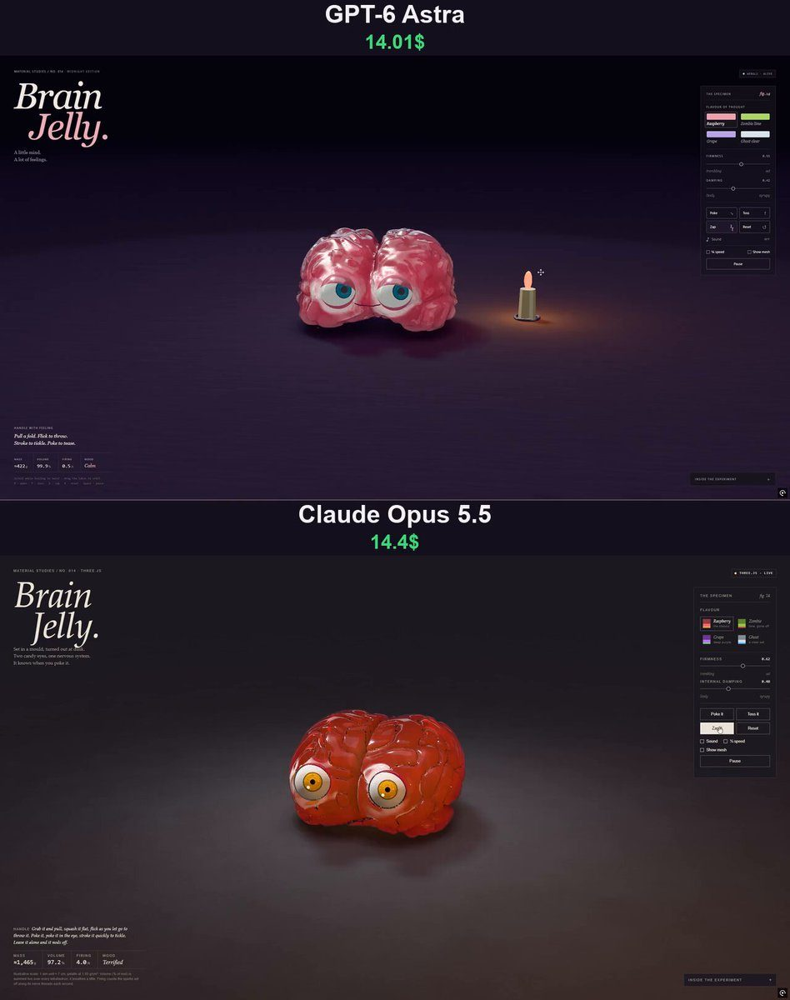

# 果冻大脑 Brain Jelly

- **类型**：交互网页 / 软体果冻
- **技术栈**：three.js · WebGL2 · XPBD 四面体软体 · 单文件 HTML
- **标签**：`three.js` `webgl2` `xpbd` `果冻` `万圣节` `material-studies` `vibe-coding` `ai-测试`
- **测试模型**：ChatGPT-6 Astra vs Claude Opus 5.5
- **来源**：[@vib3coded](https://x.com/vib3coded) · [原帖](https://x.com/vib3coded/status/2116632234916749597) · [提示词帖](https://x.com/vib3coded/status/2116632336494190710) · 2026-11-01（北京时间） · 试玩：[ChatGPT-6 Astra](https://brain-jelly.vercel.app/) · [Claude Opus 5.5](https://claude.ai/artifact/SQA4oNG3FAF3GPbvV3r9MT)

> 说明：这是 [@vib3coded](https://x.com/vib3coded) 公开分享的提示词（测试模型见上）。界面上的按钮、标题、提示语等文字按原提示词要求保持英文（引号里的英文原样保留）。优先使用英文原文；中文翻译附在后面。

---

## 效果



## 提示词（英文原文）

```text
Build "Brain Jelly" (Material Studies No. 014), a three.js WebGL2 soft-body study in the same quality as the gelatin watermelon slice: an original, cartoon gelatin brain with a face, sitting on a dark night-studio table.
Shape: a smooth hull of ellipsoids in a smooth union (two hemispheres, two temporal lobes, a two-lobed cerebellum, flattened base). The rendered skin is the hull carved by sulci — zero-sets of a domain-warped 3D gradient noise with rounded gyri crowns — plus a deep narrow longitudinal fissure, Sylvian and transverse fissures along the seams where the ellipsoids meet, and fine parallel folia on the cerebellum; polygonised once with surface nets (~1.7 mm grid), each vertex embedded in a tetrahedron by barycentric weights, normals carried by the cofactor of each tet's deformation gradient averaged onto particles.
Physics: XPBD co-rotational tetrahedral shape matching + volume constraints on a BCC lattice stuffed into the hull and snapped to it; 60 Hz, 8 substeps, edge damping, table friction with slide and rolling damping, soft arena edge; grab with a soft patch attachment, twist with a second finger or wheel, flick-to-throw on release; the rest shape breathes (slower and deeper asleep).
Face: two rigid candy eyes riding the best-fit rotation of the jelly around them; lids are two planes through each eye's centre (upper/lower edge angles and a brow-like tilt toward the nose) that make every expression; irises follow the cursor (cross-eyed up close), blinks and saccades. Moods: calm, curious, held, annoyed/furious after pokes, eye-poke wince, terrified in the air, stretched, squeezed shut when squashed, dizzy spiral irises with orbiting stars after a hard landing, giggling crescents when stroked fast (tickle), thinking (looks up, sparks surge), drowsy → asleep with rising Z's after ~30 s, upside-down panic that hops itself upright, zapped (electric storm, twitching, crackles) then dizzy.
Sparks: ~30 nerve threads wander inside; pulses race along them, a few per second calm, a storm when excited; drawn as soft points behind the gelatin so they are refracted and absorbed, their glow lights the body from within and spills on the table.
Rendering: six THREE.Scene passes — key-light shadow map (PCSS-lite, tinted), top-down contact AO, scene (table, eyes, lids, bubbles, sparks; MSAA half-float), back-face depth for view-ray thickness, gelatin pass with refraction, Beer–Lambert absorption (denser in the folds), cloudy wisps, rim glow, studio softbox reflections dulled in sulci, a flickering candle off to the right; Khronos PBR Neutral tone mapping.
UI: editorial dark page, masthead "Brain Jelly.", status pill, panel with four flavours (Raspberry, Zombie lime, Grape, Ghost clear), firmness and damping sliders, Poke / Toss / Zap / Reset, Sound (procedural squelch, boop, ouch, giggle, whee, zap, snore), ¼ speed, Show mesh, Pause; readouts Mass, Volume, Firing /s, Mood; notes "Inside the experiment"; stacked phone layout. Original character only.
```

---

## 提示词（中文）

构建 "Brain Jelly"（果冻大脑，Material Studies No. 014）：一个 three.js WebGL2 软体研究，质量对标之前的明胶西瓜切片——一个原创的卡通明胶大脑，带一张脸，坐在深色夜间摄影棚的桌面上。

### 形状

由若干椭球体做平滑并集（smooth union）得到的光滑外壳（两个半球、两个颞叶、一个双瓣小脑、压平的底部）。渲染出来的表皮是被脑沟（sulci）雕刻过的外壳——脑沟是经过域扭曲（domain-warped）的 3D 梯度噪声的零值集，脑回（gyri）顶部是圆润的——再加一条又深又窄的纵裂，在椭球体相接的接缝处加上外侧裂（Sylvian）和横裂，小脑上有细密平行的小叶（folia）。用 surface nets（约 1.7 mm 网格）一次性多边形化；每个顶点按重心坐标权重嵌入一个四面体；法线由每个四面体形变梯度的余子式（cofactor）求出，再平均到粒子上。

### 物理

在塞进外壳并贴合外壳的 BCC 晶格上，用 XPBD 共旋（co-rotational）四面体形状匹配 + 体积约束；60 Hz，8 个子步，边阻尼，桌面摩擦（带滑动和滚动阻尼），软性的场地边界；用一块柔性贴片附着来抓取，第二根手指或滚轮可以扭转，松手时甩动即可抛出；静止形状会"呼吸"（睡着时更慢更深）。

### 脸

两颗刚性糖果眼睛，跟随周围果冻的最佳拟合旋转；眼睑是穿过每只眼睛中心的两个平面（上 / 下边缘角度，加上朝鼻子方向、像眉毛一样的倾斜），所有表情都靠它们做出来；虹膜跟随光标（靠得很近会变成斗鸡眼），会眨眼和扫视。

情绪：平静、好奇、被抓着、被戳几下后恼火 / 暴怒、被戳到眼睛时缩一下、在空中时惊恐、被拉伸、被压扁时紧闭双眼、重重落地后虹膜变成眩晕螺旋并有星星绕着转、被快速抚摸（挠痒）时笑成月牙眼、思考（向上看，火花涌动）、约 30 秒后犯困 → 睡着并冒出上升的 Z、倒过来时惊慌并自己蹦正、被电（电风暴、抽搐、噼啪声）之后眩晕。

### 火花

内部约有 30 条神经丝在游走；脉冲沿着它们飞驰，平静时每秒几个，兴奋时变成一场风暴；它们画成明胶后面的柔和光点，因此会被折射和吸收；光晕从内部照亮身体，并洒到桌面上。

### 渲染

六个 THREE.Scene 渲染通道——主光阴影贴图（简化版 PCSS，带色调）、俯视接触 AO、场景（桌子、眼睛、眼睑、气泡、火花；MSAA 半精度浮点）、用于视线厚度的背面深度、明胶通道（折射、Beer–Lambert 吸收（褶皱里更浓）、云雾般的絮状物、边缘辉光、在脑沟里变暗的摄影棚柔光箱反射、右侧一根摇曳的蜡烛）；色调映射用 Khronos PBR Neutral。

### 界面

- 偏杂志风的深色页面，刊头 "Brain Jelly."，一个状态胶囊（status pill）。
- 面板：四种口味 Raspberry（树莓）、Zombie lime（僵尸青柠）、Grape（葡萄）、Ghost clear（幽灵透明）；firmness（硬度）和 damping（阻尼）滑块；Poke / Toss / Zap / Reset（戳 / 扔 / 电 / 重置）；Sound（程序化的咕叽声、boop、ouch、咯咯笑、whee、电击声、呼噜声）；¼ speed（四分之一速度）；Show mesh（显示网格）；Pause（暂停）。
- 读数：Mass、Volume、Firing /s、Mood（质量、体积、每秒放电次数、情绪）。
- 说明区 "Inside the experiment"；手机上改为纵向堆叠布局。只用原创角色。
