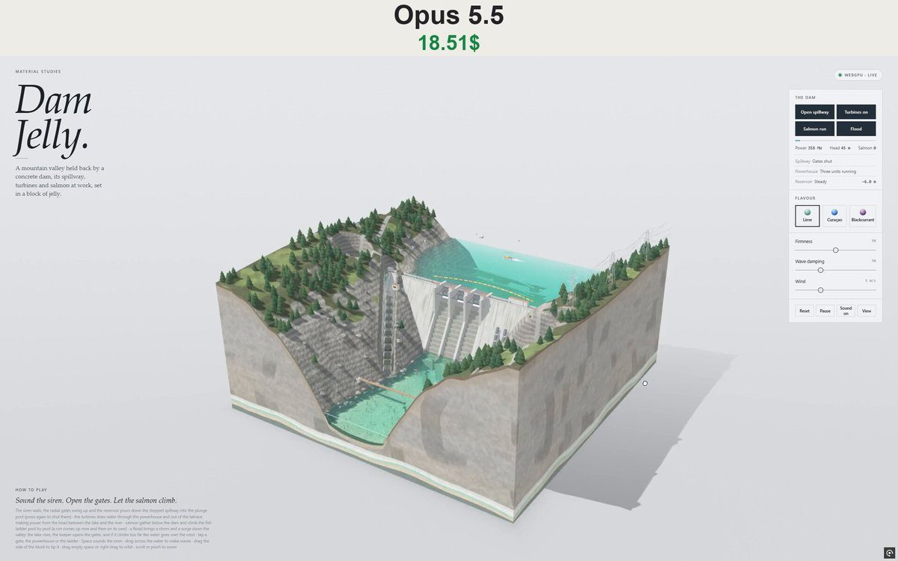

# 大坝果冻 Dam Jelly

- **类型**：交互网页 / 果冻微缩场景
- **技术栈**：WebGPU · WGSL · 浅水模拟 · 单文件 HTML
- **标签**：`webgpu` `wgsl` `浅水模拟` `果冻` `水坝` `material-studies` `vibe-coding` `ai-测试`
- **测试模型**：Claude Opus 5.5
- **来源**：[@vib3coded](https://x.com/vib3coded) · [原帖](https://x.com/vib3coded/status/2114512807500615723) · [提示词帖](https://x.com/vib3coded/status/2114512949897547782) · 2026-10-26（北京时间） · 试玩：[Claude Opus 5.5](https://claude.ai/artifact/NL5EU5Y4JnJ7EGmt8uifZt)

> 说明：这是 [@vib3coded](https://x.com/vib3coded) 公开分享的提示词（测试模型见上）。界面上的按钮、标题、提示语等文字按原提示词要求保持英文（引号里的英文原样保留）。优先使用英文原文；中文翻译附在后面。

---

## 效果



## 提示词（英文原文）

```text
Build "Dam Jelly", a new piece in my "Material Studies" series: a single-file, self-contained interactive WebGPU diorama (one HTML file, all JS/CSS/WGSL inline, no network requests, no libraries). A mountain valley with a concrete gravity dam is cut out as a wobbly block of jelly sitting on a pale studio table, seen from above at three-quarters.

SCENE (block-local coords, origin at base centre, y up, block ~5.2 × 5.2 units):
- A river valley running back to front: steep rocky slopes with crags, scree and boulders, conifer and broadleaf woods, grassy shoulders. Where the block is cut, the side faces show layered grey bedrock in tilted beds with joints, a weathered brown band and dark topsoil at the top, and gravel and silt under the water. At the very bottom are thin coloured "jelly" strata in the current flavour.
- A long reservoir behind the dam, with a bare drawdown ring of rock round its shore, a floating log boom of orange and yellow floats in front of the spillway, and a small patrol boat lapping the lake.
- A concrete gravity dam across the valley, its ends let into rock abutments: a battered downstream face with lift lines, a crest road with railings and lamps, an intake tower with trash racks and three penstocks down the face.
- A central stepped spillway with three bays between piers. Each bay has a radial (Tainter) gate: a curved skin plate on arms that swing about trunnions on the piers, with hoist houses on top. Below is an ogee crest, a stepped chute, training walls and a plunge pool scoured into the riverbed.
- A powerhouse at the right toe: a concrete base in the river, a hall of siding and tall windows, tailrace mouths. Above it, a switchyard on a terrace with transformers and gantries, and lattice pylons climbing the right slope with sagging lines.
- A fish ladder up the left bank: 14 stepped concrete pools with weirs between them from the river up to the lake, an exit gate and a counting hut at the top.
- A visitor centre on the left abutment, roads with hairpins, a suspension footbridge over the river downstream, rocks, weed and gravel bars in the river.

SIMULATION:
- Shallow-water heightfield (about 168×168), split into two bodies by the dam (reservoir and river), each with its own still level, separated by flood-fill classification. Sources, sinks and current jets make visible flow: inflow at the back of the lake, a draw toward open gates and the intake, boiling outflow in the plunge pool and tailrace, and drainage at the front edge. Foam advects on the currents.
- Reservoir level ODE: dL/dt = (Qin − Qspill − Qturbines − Qover) / AREA, where Qspill ∝ gateOpening · (L − sill)^1.5 and Qover ∝ (L − crest)^1.5. The river level rises with total outflow.
- Head-based power: 3 units × 120 MW, scaled by head.
- An automatic dam keeper opens the gates (siren first) when the lake nears the crest or a flood is coming, and shuts them again once the water is back down.
- The jelly block itself wobbles, can be tipped by dragging its side, and settles back.

INTERACTIONS (right-hand glass panel, "The dam"):
- Open spillway: a 3.5 s siren, then the gates swing up over ~9 s, and white water streams down the steps with spray and mist. Press again to shut them.
- Turbines on/off: the units spin up or down, power rises or falls, the tailrace boils or goes still, and the powerhouse windows glow while running.
- Salmon run: salmon gather below the dam, try leaping at the falls, then climb the ladder pool by pool (a leap per pool, waiting their turn) and swim out into the lake. A counter tallies fish through. Runs also arrive on their own every few minutes.
- Flood: a storm builds, blows and eases (rain, darkening, lightning hitting pylons, ridges or the lake). A big inflow surge comes down the valley: the keeper pre-releases, the lake still rises over the crest, and a white overflow sheet pours across the whole dam face. The water turns muddy brown and clears slowly afterwards.
- Tap a gate, the powerhouse or the ladder to trigger the same actions. Tap the patrol boat for its horn. Space sounds the siren.
- Tallies: Power (MW), Head (m), Salmon. Status lines: Spillway, Powerhouse, Reservoir (Rising/Falling/Steady/Flood coming in/Over the crest, with level relative to the crest in metres).
- Drag on water makes waves, drag the block's side tips it, drag empty space or right-drag orbits, wheel or pinch zooms.
- Flavour swatches (Lime, Curaçao, Blackcurrant) tint the jelly and water. Sliders for Firmness, Wave damping and Wind. Reset, Pause, Sound on/off and View buttons.

LIFE: rainbow trout in the river and lake, salmon, mallards (drakes and hens) paddling and taking off, herons wading and stalking, ospreys circling and plunge-diving for fish, people walking the crest (who pause at the siren), the powerhouse yard, the visitor centre and the footbridge, and a fisherman on the bank. Animals startle at the siren, lightning and splashes.

SOUND (synthesised with WebAudio, events only, no constant ambience): motor siren, gate-hoist clunk and drone, the spillway's rush as the gates lift, turbine spin-up and spin-down whine, a rumble of overtopping, salmon leaps, a chime for each fish counted, osprey splashes, the boat horn, thunder, and wind and rain only while a storm blows.

RENDERING: WebGPU with MSAA, a sun shadow map, caustics on the riverbed, refraction and absorption through the water and the jelly, Fresnel reflections, translucent premultiplied passes for spray and mist puffs, white-water sheets, ladder pools and rain, and a muddy-water tint during floods.

UI and layout: editorial look with an italic serif masthead ("Material Studies" eyebrow, "Dam Jelly." title, a one-line description) and a "How to play" footer at bottom left. On mobile the controls panel becomes a bottom sheet. If WebGPU is unavailable, show a clear fallback card. Respect prefers-reduced-motion. No page scroll.

QUALITY: keep the sim around 2 ms/frame, no NaNs over long soaks, everything stays inside the block, the boat always afloat. Verify with headless Playwright screenshots (SwiftShader WebGPU) and an end-to-end test that drives every button, tap target, slider and the mobile sheet, and checks for zero console errors.
```

---

## 提示词（中文）

构建 "Dam Jelly"（大坝果冻），这是我 "Material Studies" 系列的新作品：一个单文件、完全独立的交互式 WebGPU 微缩场景（一个 HTML 文件，所有 JS/CSS/WGSL 内联，不发网络请求，不用库）。一座带混凝土重力坝的山谷被切成一块晃动的果冻，立在浅色的摄影棚桌面上，以四分之三俯视角观看。

### 场景（方块局部坐标，原点在底部中心，y 向上，方块约 5.2 × 5.2 单位）

- 一条从后往前流的河谷：陡峭的岩石山坡，带峭壁、碎石坡和巨石，针叶林和阔叶林，长草的山肩。方块的切面上能看到倾斜成层、带节理的灰色基岩，一条风化的褐色带，顶部是深色表土，水下是砾石和淤泥。最底部是几层当前口味颜色的薄"果冻"地层。
- 坝后一座狭长的水库，岸边有一圈裸露的消落带岩石，泄洪道前方有一道由橙色和黄色浮筒组成的浮木拦栅，还有一艘小巡逻艇在湖上绕圈。
- 一座横跨山谷的混凝土重力坝，两端嵌进岩石坝肩：倾斜的下游坝面带浇筑分层线，坝顶道路有栏杆和路灯，一座带拦污栅的进水塔，三条压力管道顺坝面而下。
- 中间是一道阶梯式溢洪道，闸墩之间有三个闸孔。每个闸孔有一扇弧形闸门（Tainter 闸门）：弧形面板装在支臂上，绕闸墩上的支铰转动，顶上有启闭机房。下方是 ogee 型（WES）堰顶、阶梯式泄槽、导墙，以及冲刷进河床的消力池。
- 右侧坝脚是一座发电厂房：河中的混凝土基础，墙板和高窗组成的厂房，尾水出口。其上方阶地上是开关站，有变压器和门型架，格构式电塔沿右侧山坡爬升，导线下垂。
- 左岸一条鱼道：14 级阶梯式混凝土水池，池间有堰，从河一直通到湖，顶上有出口闸门和一间计数小屋。
- 左坝肩上有游客中心，发卡弯道路，下游一座横跨河流的吊桥，河里有石头、水草和砾石滩。

### 模拟

- 浅水高度场（约 168×168），被大坝分成两个水体（水库和河流），各自有自己的静水位，通过泛洪填充分类分开。源、汇和水流喷射产生可见的水流：湖后方的入流、朝打开的闸门和进水口的吸流、消力池和尾水里翻滚的出流，以及前缘的排水。泡沫随水流平流。
- 水库水位常微分方程：dL/dt = (Qin − Qspill − Qturbines − Qover) / AREA，其中 Qspill ∝ gateOpening · (L − sill)^1.5，Qover ∝ (L − crest)^1.5。河流水位随总出流上涨。
- 按水头计算发电：3 台机组 × 120 MW，按水头缩放。
- 自动的大坝管理员在湖水接近坝顶或洪水将至时开闸（先拉警报），水位回落后再关闸。
- 果冻方块本身会晃动，拖动侧面可以把它推歪，然后它会回稳。

### 交互（右侧玻璃面板 "The dam"）

- Open spillway（开启溢洪道）：先响 3.5 秒警报，然后闸门在约 9 秒内向上转开，白色水流顺着台阶倾泻而下，带水花和水雾。再按一次关闸。
- Turbines on/off（水轮机开 / 关）：机组加速或减速，功率升降，尾水翻滚或平静，运行时厂房窗户发光。
- Salmon run（鲑鱼洄游）：鲑鱼聚集在坝下，试着跃上瀑布，然后一级一级爬鱼道（每级跳一次，排队等待），游进湖里。计数器记录通过的鱼数。洄游鱼群每隔几分钟也会自己来。
- Flood（洪水）：风暴酝酿、爆发、减弱（下雨、天色变暗、闪电劈中电塔、山脊或湖面）。一股巨大的入流洪峰顺山谷而下：管理员提前泄洪，但湖水依然漫过坝顶，一整片白色溢流水幕从整个坝面倾泻而下。水变成浑浊的泥褐色，之后慢慢变清。
- 点闸门、厂房或鱼道会触发同样的动作。点巡逻艇会鸣笛。空格键拉警报。
- 计数：Power (MW)、Head (m)、Salmon（功率、水头、鲑鱼）。状态行：Spillway、Powerhouse、Reservoir（溢洪道、厂房、水库：Rising / Falling / Steady / Flood coming in / Over the crest（上涨 / 下降 / 稳定 / 洪水将至 / 漫顶），并显示相对坝顶的水位（米））。
- 在水面上拖动产生波浪，拖动方块侧面会推歪它，拖空白处或右键拖动环绕，滚轮或双指缩放。
- 口味色块（Lime、Curaçao、Blackcurrant：青柠、蓝橙酒、黑醋栗）给果冻和水着色。滑块：Firmness、Wave damping、Wind（硬度、波浪阻尼、风）。按钮：Reset、Pause、Sound on/off、View。

### 生物

河里和湖里的虹鳟、鲑鱼、绿头鸭（公鸭和母鸭）划水和起飞、苍鹭涉水潜行、鹗盘旋并俯冲入水抓鱼、在坝顶散步的人（警报响时会停下）、厂房院子、游客中心和吊桥上的人，以及岸边的一个钓鱼人。动物会被警报、闪电和水花惊到。

### 声音（WebAudio 合成，只在事件时发声，没有持续环境音）

电动警报、闸门启闭机的咔哒声和嗡鸣、闸门升起时溢洪道的奔流声、水轮机加速和减速的呜呜声、漫顶的隆隆声、鲑鱼跳跃、每数一条鱼的一声叮、鹗入水的水花声、船笛、雷声，风雨声只在风暴期间出现。

### 渲染

WebGPU，带 MSAA、太阳阴影贴图、河床焦散、穿过水和果冻的折射与吸收、菲涅尔反射；水花和雾团、白水水幕、鱼道水池和雨用半透明预乘 alpha 通道；洪水期间加泥水色调。

### 界面和布局

杂志风，斜体衬线刊头（小标题 "Material Studies"，标题 "Dam Jelly."，一行描述），左下角一个 "How to play" 页脚。手机上控制面板变成底部抽屉。没有 WebGPU 时显示清晰的降级卡片。遵循 prefers-reduced-motion。页面不滚动。

### 质量

模拟保持在每帧约 2 ms，长时间运行不出现 NaN，所有东西都留在方块内，船永远浮着。用无头 Playwright 截图（SwiftShader WebGPU）验证，并做一个端到端测试，操作每个按钮、点击目标、滑块和手机抽屉，并检查控制台零错误。
