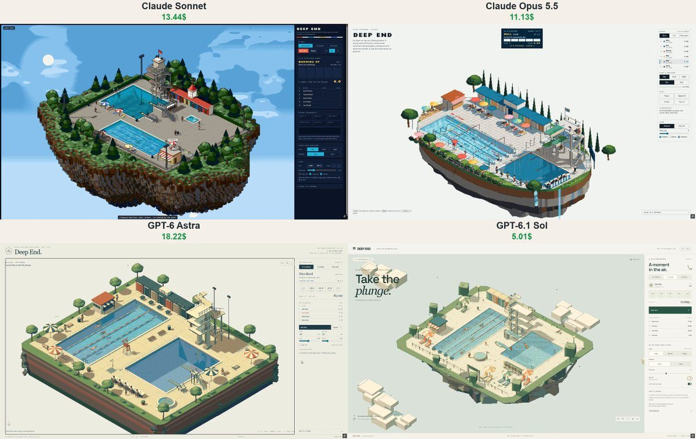

# 深水区 Deep End

- **类型**：交互网页 / 像素风场景
- **技术栈**：three.js · 像素后处理 · 跳水物理
- **标签**：`three.js` `像素风` `跳水` `泳池` `体育模拟` `vibe-coding` `ai-测试`
- **测试模型**：Claude Sonnet 5.5 vs Claude Opus 5.5 vs ChatGPT-6 Astra vs GPT-6.1 Sol
- **来源**：[@vib3coded](https://x.com/vib3coded) · [原帖](https://x.com/vib3coded/status/2115595806665240630) · [提示词帖](https://x.com/vib3coded/status/2115596228171874731) · 2026-10-29（北京时间） · 试玩：[Claude Sonnet 5.5](https://claude.ai/artifact/QpRw1by7ashXBGJL6SzGtD) · [GPT-6.1 Sol](https://deep-end-lido.vercel.app/) · [ChatGPT-6 Astra](https://deep-end-island.vercel.app/) · [Claude Opus 5.5](https://claude.ai/artifact/1WPkkpUYj4pCf8JEd62cYt)

> 说明：这是 [@vib3coded](https://x.com/vib3coded) 公开分享的提示词（测试模型见上）。界面上的按钮、标题、提示语等文字按原提示词要求保持英文（引号里的英文原样保留）。优先使用英文原文；中文翻译附在后面。

---

## 效果



## 提示词（英文原文）

```text
Build "Deep End": an open-air lido on a floating island of earth and rock, rendered as a real-time 3D scene in pixel art (three.js, orthographic isometric camera rendering into a small low-res target, no anti-aliasing, depth-buffer outlines, every pixel snapped to a fixed 64-colour palette matched in OKLab; quarter-turn rotation, zoom, pixel-size slider, Raw 3D toggle).
Scene: a 25 m lap pool and a 5 m deep diving pool cut into a concrete deck; 1 m and 3 m springboards that visibly bend; a 1930s concrete diving tower with platforms at 5, 7.5 and 10 m and an open stair; striped changing cabins with a clock, a kiosk, loungers and parasols; a judges' table.
Diving meet with real physics: each dive is flown, not animated — takeoff speed and angular momentum are solved to land the somersaults, angular momentum is conserved so tucking spins the diver faster and kicking out slows them to line up the entry. Divers kick out slightly early or late (more on harder dives), the entry angle sets the splash, five judges hold up score cards, highest and lowest are dropped, the rest are multiplied by the degree of difficulty. Events: 10 m, 3 m, free swim.
Water: each pool surface is a wave-equation height field (~20 cm cells) — entries, strokes, rain and clicks make rings that bounce off the walls; shaded from its normals with sun glints and a mirrored reflection of the lido; caustics on the tiled floor.
People: box-rig figures with two-bone IK — swimmers doing freestyle, breaststroke and backstroke with flip turns; divers swim to the ladder, shower, sit in the warm tub and climb again; children who run and get whistled at by the lifeguard; wet footprints on the deck that dry in the sun.
Light and weather: day / dusk / night (pool lights glow underwater, tower floodlights at night), dry / rain (rain rings the water and darkens the deck). Click the water to make a splash. Side panel with the meet scoreboard, controls and a short "How it's drawn" note. Original fictional content only, English UI.
```

---

## 提示词（中文）

构建 "Deep End"（深水区）：一座建在土石浮空岛上的露天泳场（lido），用像素画风格渲染成实时 3D 场景（three.js，正交等距相机渲染到一个很小的低分辨率目标上，不抗锯齿，深度缓冲描边，每个像素都吸附到一个固定的 64 色调色板（在 OKLab 空间匹配）；支持 90° 旋转、缩放、像素尺寸滑块，以及 Raw 3D 开关）。

### 场景

在混凝土池岸上开出一个 25 m 标准泳道池和一个 5 m 深的跳水池；1 m 和 3 m 跳板会明显弯曲；一座 1930 年代的混凝土跳台，有 5 m、7.5 m 和 10 m 平台和一条敞开的楼梯；条纹更衣小屋（带一个钟）、一个小卖亭、躺椅和遮阳伞；一张裁判桌。

### 有真实物理的跳水比赛

每一跳都是真的"飞"出来的，而不是播放动画——起跳速度和角动量通过求解来保证空翻能落准；角动量守恒，所以抱膝会让跳水者转得更快，打开身体会让他们减速以对准入水角度。跳水者打开身体会稍早或稍晚（难度越高的动作偏差越大），入水角度决定水花大小；五名裁判举起打分牌，去掉最高分和最低分，其余分数乘以难度系数。项目：10 m、3 m、自由泳。

### 水

每个池子的水面都是一个波动方程高度场（约 20 cm 一格）——入水、划水、雨和点击都会激起圈圈波纹，并在池壁上反弹；用法线着色，有阳光闪点和泳场的镜面倒影；瓷砖池底有焦散。

### 人

方块骨架小人，带双骨骼 IK——游泳者游自由泳、蛙泳和仰泳，带翻滚转身；跳水者游到扶梯、冲澡、坐进温水池，然后再去爬台；会奔跑的小孩，被救生员吹哨警告；池岸上的湿脚印会在阳光下慢慢变干。

### 光照和天气

白天 / 黄昏 / 夜晚（池灯在水下发光，夜里跳台有泛光灯），晴 / 雨（雨在水面上打出圈圈，让池岸变暗）。点击水面可以溅起水花。侧边面板显示比赛记分板、控制项，以及一段简短的 "How it's drawn" 说明。只用原创虚构内容，界面用英文。
