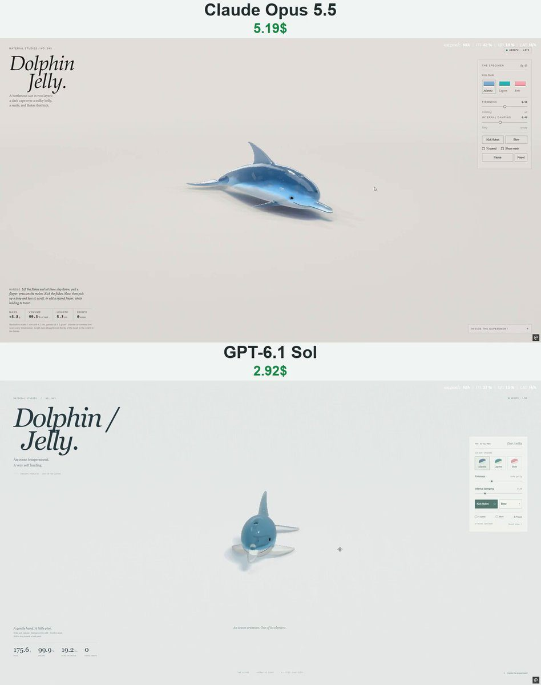

# 果冻海豚 Dolphin Jelly

- **类型**：交互网页 / 软体果冻
- **技术栈**：WebGPU · WGSL · XPBD 四面体软体
- **标签**：`webgpu` `wgsl` `xpbd` `果冻` `海豚` `material-studies` `vibe-coding` `ai-测试`
- **测试模型**：Claude Opus 5.5 vs GPT-6.1 Sol
- **来源**：[@vib3coded](https://x.com/vib3coded) · [原帖](https://x.com/vib3coded/status/2115015297195225283) · [提示词帖](https://x.com/vib3coded/status/2115015438346101190) · 2026-10-27（北京时间） · 试玩：[GPT-6.1 Sol](https://dolphin-jelly.vercel.app/) · [Claude Opus 5.5](https://claude.ai/artifact/Jqm5rF2XjhkrAn26x7sP1q)

> 说明：这是 [@vib3coded](https://x.com/vib3coded) 公开分享的提示词（测试模型见上）。界面上的按钮、标题、提示语等文字按原提示词要求保持英文（引号里的英文原样保留）。优先使用英文原文；中文翻译附在后面。

---

## 效果



## 提示词（英文原文）

```text
Build "Dolphin Jelly" — Material Studies No. 045: an interactive WebGPU soft-body study of a bottlenose dolphin cast in two layers of jelly, lying on its belly on a pale studio sweep. Same engine as the jelly series (WGSL, no libraries): signed-distance shape → surface-nets render mesh + snapped hex lattice (5 tets/cell) for XPBD with co-rotational shape matching, volume constraints, floor friction, soft grab with twist; shadow map, contact AO, back-face thickness, refraction, Beer–Lambert absorption, thin-part glow, PBR Neutral tone map.
Shape: elliptical section swept along the spine — round melon, deep chest, tall laterally-compressed tail stock, belly pressed flat; a short tapering beak smooth-unioned tightly so a crease stays at the melon; a blowhole dimple. Fins from one recipe (flat triangle, convex leading edge, falcate trailing edge, thinning to the tip): hooked dorsal, small pointed flippers, swept flukes whose roots cross the midline so the trailing edges meet in a median notch.
Two layers: clear jelly over a milky belly whose countershading line runs as a long low wave and forward under the eye to the mouth corner, so throat and lower jaw are pale. Shader in rest space: a darker cape as a pigment film (lowest under the dorsal fin, wrapping the tail stock, on the upper jaw only), eye-to-flipper blaze, eye shadow, blowhole stripe, the smile along the jaw line turning up at the corner, blowhole crescent, a few sets of parallel rake-mark scars different on each side; dark glossy eyes; trapped bubbles.
Interaction: "Kick flukes" drives a dorso-ventral stroke by muscle strain — each tet's rest shape is lengthened/shortened along the body by curvature × its height above/below the spine (volume-preserving), stronger toward the flukes, softened for a very soft jelly. "Blow": a short explosive chuff of jelly drops from the blowhole along its live axis; drops bounce, collide with the deformed body, can be tossed. Palettes Atlantic / Lagoon / Boto (pink river-dolphin nod); readouts mass, volume %, beak-to-notch length, loose drops; firmness & damping sliders, ¼ speed, mesh overlay, pause, reset; editorial UI in English.
```

---

## 提示词（中文）

构建 "Dolphin Jelly"（海豚果冻）—— Material Studies No. 045：一个交互式 WebGPU 软体研究，一只用两层果冻浇铸成的宽吻海豚，趴在浅色的摄影棚无缝背景上。

### 引擎

与果冻系列相同（WGSL，不用库）：有符号距离场形状 → surface-nets 渲染网格 + 吸附的六面体晶格（每格 5 个四面体），用于 XPBD（共旋形状匹配、体积约束、地面摩擦、可扭转的柔性抓取）；阴影贴图、接触 AO、背面厚度、折射、Beer–Lambert 吸收、薄处透光辉光、PBR Neutral 色调映射。

### 形状

沿脊柱扫掠的椭圆截面——圆圆的额隆（melon）、深胸、高而侧扁的尾柄、腹部压平；一个短而渐尖的喙，平滑并集得很紧，让额隆处保留一道折痕；一个喷气孔凹坑。鳍用同一个配方（扁平三角形、前缘外凸、后缘镰形、向尖端变薄）：钩状背鳍、小而尖的鳍肢、后掠的尾叶，尾叶根部越过中线，让两侧后缘在中间的缺刻处相接。

### 两层果冻

透明果冻包着乳白色的腹部；反荫蔽分界线像一道长而低的波浪，往前一直经过眼睛下方到嘴角，所以喉部和下颌是浅色的。在静止空间里用着色器绘制：一层颜色更深的"披风"色素膜（在背鳍下方最低，包住尾柄，只在上颌上）、从眼睛到鳍肢的条纹、眼影、喷气孔条纹、沿颌线的微笑（在嘴角处上扬）、喷气孔的月牙、几组平行的齿耙伤痕（两侧不同）；深色有光泽的眼睛；被困住的气泡。

### 交互

- "Kick flukes"（踢尾）：通过肌肉应变驱动背腹方向的摆尾——每个四面体的静止形状沿身体方向按"曲率 × 它在脊柱上方 / 下方的高度"伸长或缩短（保持体积），越靠近尾叶越强，果冻很软时减弱。
- "Blow"（喷气）：沿喷气孔的实时轴向，短促爆发地喷出一串果冻水滴；水滴会弹跳、与变形的身体碰撞，也可以被抛来抛去。
- 配色 Atlantic / Lagoon / Boto（大西洋 / 潟湖 / 粉色亚马孙河豚致敬）；读数：质量、体积 %、喙端到尾缺刻长度、散落的水滴数；firmness 和 damping 滑块、¼ speed、网格叠加、暂停、重置；杂志风的英文界面。
