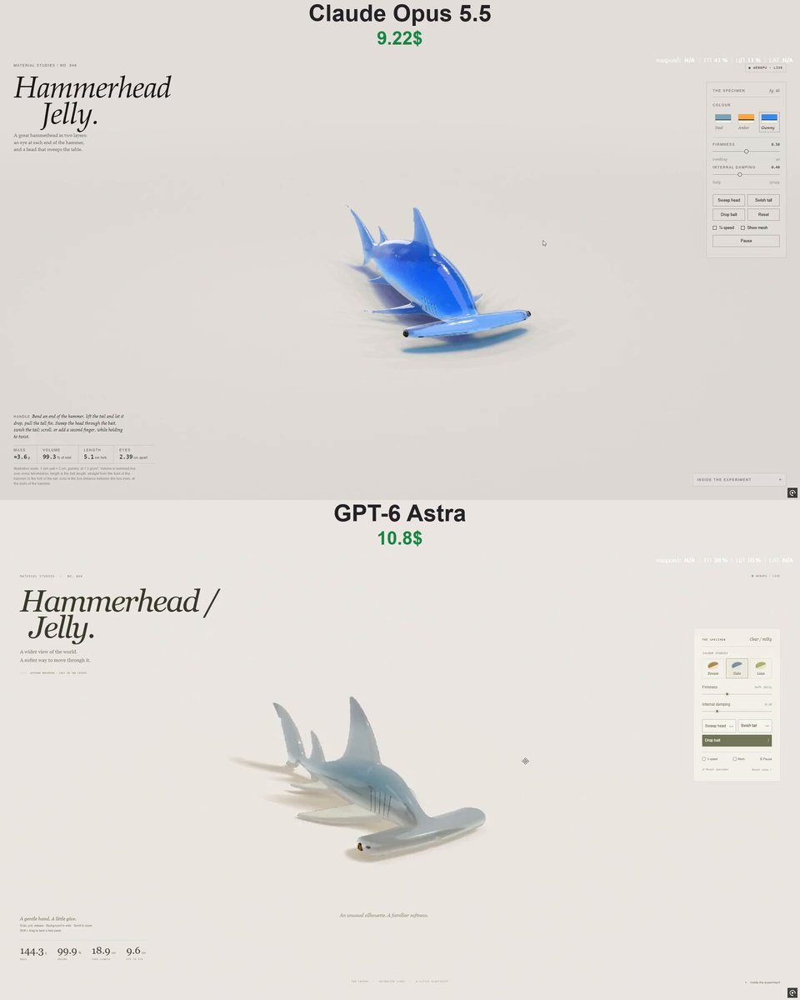

# 果冻双髻鲨 Hammerhead Jelly

- **类型**：交互网页 / 软体果冻
- **技术栈**：WebGPU · XPBD 四面体软体 · SDF
- **标签**：`webgpu` `xpbd` `果冻` `双髻鲨` `vibe-coding` `ai-测试`
- **测试模型**：Claude Opus 5.5 vs ChatGPT-6 Astra
- **来源**：[@vib3coded](https://x.com/vib3coded) · [原帖](https://x.com/vib3coded/status/2115402023935893904) · [提示词帖](https://x.com/vib3coded/status/2115402115392680290) · 2026-10-28（北京时间） · 试玩：[Claude Opus 5.5](https://claude.ai/artifact/NPppb6VRHiEN7spHcLDTuP) · [ChatGPT-6 Astra](https://hammerhead-jelly.vercel.app/)

> 说明：这是 [@vib3coded](https://x.com/vib3coded) 公开分享的提示词（测试模型见上）。界面上的按钮、标题、提示语等文字按原提示词要求保持英文（引号里的英文原样保留）。优先使用英文原文；中文翻译附在后面。

---

## 效果



## 提示词（英文原文）

```text
Make an interactive WebGPU soft-body study of a great hammerhead shark cast in two layers of jelly, resting on its belly in a soft photo studio. Build it from a signed distance field: an elliptical body section swept along the spine, slim at the neck, deep at the chest, with a slim caudal peduncle. Give it an oversized cephalofoil — a wide, flat hammer whose span is about 40% of the body length, with a nearly straight front edge, a small notch in the middle, ends swept slightly back, full and round at the front and thinning toward the back, with a large glossy eye at each tip. Seven kinds of fin from one recipe (convex leading edge, falcate trailing edge, thinning toward the tip): a very tall sickle-shaped first dorsal, second dorsal, pectorals, tall pelvic fins, anal fin and a lopsided tail with a subterminal notch. Clear tinted jelly over a milky white belly layer that also fills the underside of the hammer; trapped bubbles; a darker back, dusky fin tips, five gill slits, a small crescent mouth with milky teeth, grooves along the front of the hammer and pores beneath it, all drawn in the shader from rest-space coordinates so they stretch with the jelly. Simulate it as an XPBD tetrahedral mesh (snapped hex lattice, co-rotational elasticity, volume preservation, floor friction), with firmer fins. Muscle strain drives two moves: a slow head sweep from side to side, like a metal detector over the sand, and a tail swish. Let the user grab and stretch the jelly, twist with the scroll wheel or a second finger, drop beads of jelly bait, and switch between three colourways (steel, amber, gummy blue). Render with refraction, Beer–Lambert absorption, back-lit glow in the thin parts and tinted shadows. Show live mass, volume, fork length and the distance between the eyes.
```

---

## 提示词（中文）

做一个交互式 WebGPU 软体研究：一条用两层果冻浇铸成的无沟双髻鲨（great hammerhead），在柔和的摄影棚里趴着。

- 用有符号距离场构建：沿脊柱扫掠的椭圆形身体截面，颈部细，胸部深，尾柄纤细。
- 给它一个超大的头翼（cephalofoil）——又宽又平的"锤头"，展幅约为体长的 40%，前缘几乎是直的，中间有一个小缺口，两端略向后掠，前部饱满圆润、往后逐渐变薄，每个端头各有一只大而有光泽的眼睛。
- 用同一个配方生成七种鳍（前缘外凸、后缘镰形、向尖端变薄）：一个非常高的镰刀状第一背鳍、第二背鳍、胸鳍、高高的腹鳍、臀鳍，以及一个带次端缺刻的不对称尾鳍。
- 透明带色的果冻包着乳白色的腹部层，这一层也填满锤头的下侧；里面有被困住的气泡；背部更深，鳍尖暗色，五条鳃裂，一张小小的月牙形嘴（带乳白色牙齿），锤头前缘有沟槽、下方有小孔——全部在着色器里用静止空间坐标绘制，所以会随果冻一起拉伸。
- 用 XPBD 四面体网格模拟（吸附的六面体晶格、共旋弹性、体积保持、地面摩擦），鳍更硬。肌肉应变驱动两个动作：头部缓慢左右扫动，像在沙滩上用金属探测器；以及甩尾。
- 让用户可以抓住并拉伸果冻，用滚轮或第二根手指扭转，投放果冻诱饵珠子，并在三种配色之间切换（steel、amber、gummy blue：钢灰、琥珀、软糖蓝）。
- 渲染：折射、Beer–Lambert 吸收、薄处的背光透光辉光和带色阴影。显示实时质量、体积、叉长和两眼间距。
