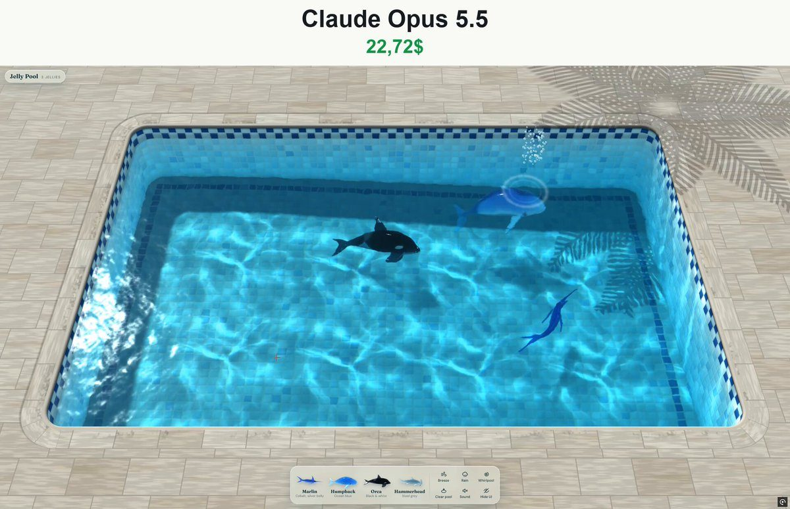

# 果冻泳池 Jelly Pool

- **类型**：交互网页 / 软体果冻
- **技术栈**：three.js r128 · WebGL2 · Web Worker · XPBD · 单文件 HTML
- **标签**：`three.js` `webgl2` `xpbd` `果冻` `泳池` `焦散` `vibe-coding` `ai-测试`
- **测试模型**：Claude Opus 5.5
- **来源**：[@vib3coded](https://x.com/vib3coded) · [原帖](https://x.com/vib3coded/status/2115912302272618696) · [提示词帖](https://x.com/vib3coded/status/2115912474566488307) · 2026-10-30（北京时间） · 试玩：[Claude Opus 5.5](https://claude.ai/artifact/9NMKuU4dWkwEkpxsH769rP)

> 说明：这是 [@vib3coded](https://x.com/vib3coded) 公开分享的提示词（测试模型见上）。界面上的按钮、标题、提示语等文字按原提示词要求保持英文（引号里的英文原样保留）。优先使用英文原文；中文翻译附在后面。

---

## 效果



## 提示词（英文原文）

```text
Build "Jelly Pool": a single self-contained HTML file. It shows a sunlit outdoor swimming pool in real-time 3D, and the user drops soft-body jelly sea animals into it: a marlin, a humpback whale, an orca and a hammerhead shark. Each animal is made of clear, wobbly jelly that refracts the pool behind it and has a milky core and dark glossy eyes. It splashes in, dives and swims with a travelling body wave, and wobbles as it turns. The whales surface to breathe and blow spray. Everything is procedural: no image, model or sound files. English UI.

TECH
- three.js r128 from cdnjs (UMD build, global THREE), WebGL 2 required. If WebGL 2 is missing, show a friendly fallback message.
- Soft-body physics runs in Web Workers created from a blob URL. Put the worker source in a <script type="text/plain"> tag in the page and use navigator.hardwareConcurrency − 1 workers, clamped to 1–3. Spread the animals across the workers and give each new animal to the least busy one.
- Each step, the main thread sends the swim frames to the workers. The workers reply with packed Float32Arrays as transferables.
- Use adaptive quality: lower the internal render scale when frames run slow. On coarse-pointer or low-core devices, use coarser jelly meshes and cap the pool at 6 animals instead of 8.

THE POOL
- A rounded-rectangle pool under a pitched perspective camera, fitted to the screen in any aspect ratio. The floor slopes from a shallow end on the left (≈0.55 m) to a deep end on the right (≈1.85 m).
- Pale stone deck. Coping blocks with a rounded bullnose edge overhanging the waterline, standing a little proud of the deck, with a soft shadow along their outer edge and darker splash-wet stone near the water.
- Shell: procedural mosaic tiles in a shader (field, border and a darker waterline band), each tile with bevel normals and a glassy glaze highlight.
- Dappled shadow from a palm crown leaning over one corner, moving gently in the breeze.
- Water simulation: a GPU heightfield wave equation on ping-pong float render targets, damped, with walls as boundaries. Touching or dragging across the water makes ripples. Add a slow circulation from return jets and gentle lapping swells.
- Water surface: computed normals, refraction of the shell and the animals beneath (with the deep end bluer and darker), Fresnel reflection of the sky, and a reflection of the coping and the tiled wall band. Add a sharp sun glint, a meniscus and coping shadow along the walls, and foam patches from splashes.
- Caustics: refract a grid of sun rays through the surface heightfield onto the floor into a caustic texture (area-change brightness). Use it to light the shell and anything under water.
- Tools on the water:
  - Breeze: wind ripples from scrolling noise gradients.
  - Rain: random drop impulses plus ring ripples, and rain sound.
  - Whirlpool: a vortex that swirls the surface and the animals, a darkened funnel and spiral foam arms.

THE ANIMALS (soft bodies)
- Define each species as a signed-distance body: smooth unions of ellipsoids and capsules, with fins as flattened shapes.
  - Marlin: long bill, tall sail fin, forked tail.
  - Humpback: long pectoral fins, throat pleats, knobby head.
  - Orca: tall dorsal fin, rounded head.
  - Hammerhead: wide cephalofoil, tall dorsal.
- From the SDF, build:
  1. A tetrahedral simulation lattice: a voxel grid, keeping cells that intersect the body, each split into tets.
  2. A smooth render surface via surface nets, plus an inner milky core from an offset SDF and two eyes.
  3. An embedding: each render vertex is stored as the tet that contains it plus barycentric weights.
- Physics in the worker, XPBD:
  - co-rotational shape matching per tet (warm-start rotations) plus edge-based internal viscosity, firmer in the core than the skin;
  - in the water (y < 0) the body is weightless with quadratic drag; above the water, gravity, so it falls back with a splash;
  - steering through a soft "hold" constraint that pulls the chest and head nodes (never fins or tail) toward a swim frame (position + rotation) moved by the main thread;
  - swimming by strain: a travelling wave of target lengthening and shortening along the spine toward the tail. It is side to side for fish (marlin, hammerhead) and up and down for whales (humpback, orca, using each tet's offset above or below the spine), with a bend toward the direction of a turn.
- Output per step: node positions plus a per-node cofactor matrix of the deformation gradient F = Ds·Dm⁻¹ (columns f1×f2, f2×f0, f0×f1), averaged over the surrounding tets. Pack them as four rows of RGBA texels per node (position, then three cofactor columns) so the GPU can transform rest normals to deformed normals.

JELLY RENDERING (GPU skinning + passes)
- Upload the node texture as a float DataTexture each frame. In the vertex shader, use texelFetch to read the 4 nodes of the embedding tet, blend the positions with the barycentrics, and transform the rest normal with the blended cofactor.
- Pass order:
  1. Opaque under-water scene into an RGBA half-float target: the shell, bubbles, and each animal's milky core and eyes, lit by caustic sunlight through the surface. Store the view depth in alpha.
  2. Jelly back faces into a float target: the linear view depth of the far side.
  3. Jelly front faces:
     - thickness = back depth − front depth;
     - Beer–Lambert absorption with a per-species tint;
     - refraction: bend the view ray and sample the opaque target behind;
     - Fresnel sky reflection and sun specular;
     - a soft glow where the sun passes through thin parts (fins, tail).
  4. A pale, soft floor shadow per animal, with the core a little denser.
  5. The water surface composited over everything, so animals under water are seen through the refracting, caustic-lit water, and parts above the water are seen directly.
- Pigment patterns live in rest-space coordinates, so they ride the wobble. Each is a filtering film on the back, not paint:
  - marlin: cobalt back with a wavering edge and a silver belly, vertical bars on the flank that glow brighter when it is excited (soften them at a distance to avoid moiré), dark fins, the bill dark above;
  - humpback: no pigment, only throat pleats and a mouth line as shadowed grooves;
  - orca: black above the white line and on every fin, the white eye patch, a grey saddle;
  - hammerhead: a steel-grey cape over the back and the top of the hammer, dusky fin tips, five gill slits.
- Eyes: glossy dark beads with a pale ring and a wide pupil.

BEHAVIOUR
- Steering field: an SDF of where an animal may swim and still be seen. Keep it inside the walls, away from the band hidden under the near coping (the band gets wider the deeper the animal swims) and out from under the dock of cards, leaning back toward the open middle.
  - Keep the centre, snout and tail inside.
  - Wander in depth.
  - Animals separate from each other (steering plus a direct positional push, so two bodies never share the water).
- Whales: humpback and orca surface every so often. The back breaks the surface, then they blow: a puff of spray from the blowhole and a ring of ripples.
- Close under the surface an animal leaves wakes, and the swish of a turn makes ripples. Crossing the surface makes splashes, droplets and foam.
- States: in the air (held or thrown), diving in, swimming, leaving.
- "Clear pool": the animals rise out of the water and melt away back into their cards.
- Start state: a humpback and a marlin already swimming, and an orca thrown in a moment later.

INTERFACE (glass dock at the bottom, light and clean)
- Four cards, each with:
  - a live thumbnail of the jelly animal in its rest pose, rendered with the same shaders;
  - name and short description: Marlin "Cobalt, silver belly", Humpback "Ocean blue", Orca "Black & white", Hammerhead "Steel grey".
- Card interaction:
  - tap a card: the animal is tossed into the pool;
  - drag a card: the animal hangs over the water under the pointer, dangling and wobbling, and drops in where it is released.
- Tool buttons with SVG icons: Breeze (B), Rain (R), Whirlpool (W), Clear pool, Sound (M), Hide interface (H), plus a "Show interface" restore button.
- Also:
  - a brand label "Jelly Pool" with a live count ("Empty pool", "3 jellies");
  - a hint: "Tap a jelly to release it, or drag one onto the water";
  - a toast when the pool is full: "The pool is full. Clear it to add more jellies".
- Accessibility: aria-labels on the canvas and the cards, keyboard shortcuts, respect for prefers-reduced-motion, and a responsive layout down to phone width.

SOUND (Web Audio, synthesized, off by default)
- Gentle water lapping.
- Splashes and plops scaled by impact.
- Rain hiss.
- Whale blows as a breathy whoosh.
- Breeze.
```

---

## 提示词（中文）

构建 "Jelly Pool"（果冻泳池）：一个独立的单 HTML 文件。用实时 3D 展示一个阳光下的室外泳池，用户可以把软体果冻海洋动物丢进去：一条枪鱼、一头座头鲸、一头虎鲸和一条双髻鲨。每只动物都由透明、会晃动的果冻做成，会折射身后的泳池，有一个乳白色的内核和深色有光泽的眼睛。它扑通一声落水、下潜，用沿身体传播的波动游泳，转身时会晃动。鲸会浮上水面换气并喷出水雾。一切都是程序化生成的：不用任何图片、模型或声音文件。界面用英文。

### 技术

- three.js r128，从 cdnjs 引入（UMD 版本，全局 THREE），需要 WebGL 2。如果没有 WebGL 2，显示一条友好的降级提示。
- 软体物理跑在由 blob URL 创建的 Web Worker 里。把 worker 源码放在页面里的 `<script type="text/plain">` 标签中，使用 navigator.hardwareConcurrency − 1 个 worker，限制在 1–3 个。把动物分摊到各个 worker 上，每只新动物交给最空闲的那个。
- 每一步，主线程把游动帧（swim frames）发给 worker；worker 用打包好的 Float32Array 作为 transferable 回传。
- 自适应画质：帧率掉的时候降低内部渲染分辨率。在粗指针（触屏）或低核心数设备上，使用更粗的果冻网格，并把池中动物上限从 8 只降到 6 只。

### 泳池

- 一个圆角矩形泳池，用俯角透视相机拍摄，适配任意屏幕比例。池底从左边的浅水区（约 0.55 m）倾斜到右边的深水区（约 1.85 m）。
- 浅色石材池岸。池沿压顶石带圆润的牛鼻边，探出水线之上，略高于池岸，外侧边缘有柔和阴影，靠近水的地方石头被溅湿而颜色更深。
- 池壳：在着色器里程序化生成的马赛克瓷砖（主体区域、边框和一条更深的水线带），每块瓷砖有倒角法线和玻璃釉面高光。
- 一棵棕榈树的树冠斜伸到一个角落上方，投下斑驳的影子，在微风里轻轻晃动。
- 水面模拟：在 ping-pong 浮点渲染目标上跑 GPU 高度场波动方程，带阻尼，以池壁作为边界。触摸或在水面上拖动会产生涟漪。加上回水喷口带来的缓慢环流和轻柔的拍岸涌浪。
- 水面：计算法线，折射下方的池壳和动物（深水区更蓝、更暗），菲涅尔天空反射，以及池沿和瓷砖墙带的倒影。加上锐利的阳光闪点、沿池壁的弯月面和池沿阴影，以及溅水产生的泡沫斑块。
- 焦散：把一格阳光光线穿过水面高度场折射到池底，生成焦散贴图（按面积变化计算亮度），用它照亮池壳和水下的一切。
- 水面工具：
  - Breeze（微风）：由滚动噪声梯度产生的风致涟漪。
  - Rain（雨）：随机雨滴冲击加环形涟漪，以及雨声。
  - Whirlpool（漩涡）：一个旋涡，搅动水面和动物，中间有变暗的漏斗和螺旋状的泡沫臂。

### 动物（软体）

- 把每个物种定义为有符号距离场（SDF）形体：椭球体和胶囊体的平滑并集，鳍用压扁的形状。
  - 枪鱼：长吻，高大的帆状背鳍，叉形尾。
  - 座头鲸：长长的胸鳍，喉部褶沟，头上有疙瘩。
  - 虎鲸：高高的背鳍，圆脑袋。
  - 双髻鲨：宽大的锤头（头翼），高背鳍。
- 从 SDF 构建：
  1. 四面体模拟晶格：一个体素网格，保留与身体相交的格子，每格切分成若干四面体。
  2. 用 surface nets 生成的光滑渲染表面，外加由偏移 SDF 得到的乳白色内核和两只眼睛。
  3. 嵌入关系：每个渲染顶点记录为包含它的四面体加上重心坐标权重。
- worker 里的物理，XPBD：
  - 每个四面体做共旋形状匹配（旋转做 warm-start），加上基于边的内部黏性，内核比表皮更硬；
  - 在水里（y < 0）身体失重并受二次阻力；在水面之上受重力，所以会落回水里溅起水花；
  - 转向通过一个柔性的 "hold" 约束：把胸部和头部节点（绝不包括鳍或尾）拉向由主线程移动的游动帧（位置 + 旋转）；
  - 通过应变游泳：沿脊柱向尾部传播的目标伸长 / 缩短波。鱼（枪鱼、双髻鲨）是左右摆动，鲸（座头鲸、虎鲸）是上下摆动（利用每个四面体在脊柱上方或下方的偏移），并朝转弯方向弯曲。
- 每一步输出：节点位置，加上每个节点的形变梯度 F = Ds·Dm⁻¹ 的余子式矩阵（列为 f1×f2、f2×f0、f0×f1），在周围四面体上取平均。每个节点打包成四行 RGBA 纹素（位置，然后三列余子式），让 GPU 能把静止法线变换成形变后的法线。

### 果冻渲染（GPU 蒙皮 + 多通道）

- 每帧把节点纹理作为浮点 DataTexture 上传。在顶点着色器里用 texelFetch 读取嵌入四面体的 4 个节点，用重心坐标混合位置，并用混合后的余子式变换静止法线。
- 通道顺序：
  1. 水下不透明场景渲染到 RGBA 半精度浮点目标：池壳、气泡、每只动物的乳白内核和眼睛，由穿过水面的焦散阳光照亮。视深度存在 alpha 里。
  2. 果冻背面渲染到浮点目标：远侧的线性视深度。
  3. 果冻正面：
     - 厚度 = 背面深度 − 正面深度；
     - 按物种着色的 Beer–Lambert 吸收；
     - 折射：弯折视线，采样后面的不透明目标；
     - 菲涅尔天空反射和太阳高光；
     - 阳光穿过薄的部位（鳍、尾）时的柔和透光辉光。
  4. 每只动物一个浅淡柔和的池底阴影，内核部分稍浓一点。
  5. 最后把水面合成在所有东西之上：水下的动物透过有折射、有焦散的水被看到，水面以上的部分直接可见。
- 色素花纹定义在静止空间坐标里，所以会跟着晃动。每种都是背面的一层滤色膜，而不是涂料：
  - 枪鱼：钴蓝色背部，边缘起伏，银色腹部；体侧的竖条纹在兴奋时更亮地发光（远处要柔化以避免摩尔纹）；深色的鳍；吻部上侧是深色；
  - 座头鲸：没有色素，只有喉部褶沟和嘴线，做成带阴影的凹槽；
  - 虎鲸：白线以上和所有鳍是黑色，白色眼斑，灰色鞍斑；
  - 双髻鲨：背部和锤头顶部覆盖钢灰色"披风"，鳍尖暗色，五条鳃裂。
- 眼睛：有光泽的深色珠子，带一圈浅色环和大瞳孔。

### 行为

- 转向场：一个 SDF，表示动物可以游、同时还能被看到的区域。让它们留在池壁之内，避开近侧池沿下方被遮住的那条带（动物游得越深，这条带越宽），也不要游到底部卡片栏下面，并倾向于回到开阔的中间。
  - 让身体中心、吻部和尾巴都保持在区域内。
  - 在深度上随机漫游。
  - 动物彼此分开（转向力加上直接的位置推开，保证两个身体永远不会重叠）。
- 鲸：座头鲸和虎鲸时不时浮上水面。背部先破水，然后喷气：从喷水孔喷出一团水雾，并激起一圈涟漪。
- 贴近水面游动时，动物会留下尾迹，转身的甩动会激起涟漪。穿过水面时会产生水花、水滴和泡沫。
- 状态：在空中（被拿着或被扔出）、入水、游动、离开。
- "Clear pool"（清空泳池）：动物从水里升起，融化回各自的卡片里。
- 初始状态：一头座头鲸和一条枪鱼已经在游，片刻之后一头虎鲸被扔进来。

### 界面（底部玻璃质感的卡片栏，明亮干净）

- 四张卡片，每张有：
  - 该果冻动物静止姿态的实时缩略图，用同一套着色器渲染；
  - 名字和简短描述：Marlin "Cobalt, silver belly"、Humpback "Ocean blue"、Orca "Black & white"、Hammerhead "Steel grey"（枪鱼"钴蓝，银腹"、座头鲸"海洋蓝"、虎鲸"黑白"、双髻鲨"钢灰"）。
- 卡片交互：
  - 点一下卡片：动物被抛进泳池；
  - 拖动卡片：动物挂在指针下方、悬在水面上晃荡，松手的位置落水。
- 带 SVG 图标的工具按钮：Breeze (B)、Rain (R)、Whirlpool (W)、Clear pool、Sound (M)、Hide interface (H)，以及一个 "Show interface" 恢复按钮。
- 另外：
  - 品牌标签 "Jelly Pool"，带实时数量（"Empty pool"、"3 jellies"）；
  - 提示语："Tap a jelly to release it, or drag one onto the water"（点一下放出果冻，或把它拖到水面上）；
  - 泳池满了时弹出提示："The pool is full. Clear it to add more jellies"（泳池满了，清空后才能加更多果冻）。
- 无障碍：画布和卡片带 aria-label，键盘快捷键，遵循 prefers-reduced-motion，响应式布局一直适配到手机宽度。

### 声音（Web Audio 合成，默认关闭）

- 轻柔的拍水声。
- 按冲击力度缩放的水花声和扑通声。
- 雨的沙沙声。
- 鲸喷气时带气息的呼呼声。
- 微风声。
