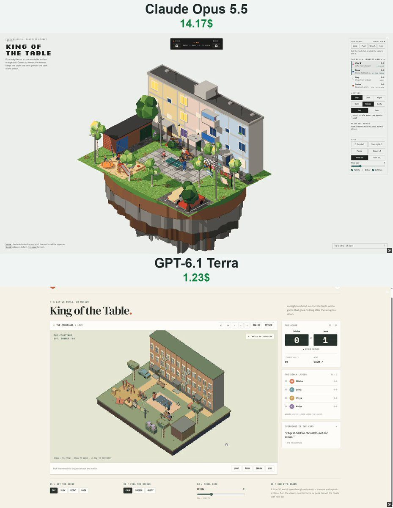

# 球台之王 King of the Table

- **类型**：交互网页 / 像素风场景
- **技术栈**：three.js r160 · 像素后处理 · 乒乓球物理 · 单文件 HTML
- **标签**：`three.js` `像素风` `乒乓球` `体育模拟` `vibe-coding` `ai-测试`
- **测试模型**：Claude Opus 5.5 vs GPT-6.1 Terra
- **来源**：[@vib3coded](https://x.com/vib3coded) · [原帖](https://x.com/vib3coded/status/2114842660829860045) · [提示词帖](https://x.com/vib3coded/status/2114842861766087147) · 2026-10-27（北京时间） · 试玩：[GPT-6.1 Terra](https://king-of-the-table-vibecoded1.vercel.app/) · [Claude Opus 5.5](https://claude.ai/artifact/6Pz9VeJwnXcr2w7Z537dTt)

> 说明：这是 [@vib3coded](https://x.com/vib3coded) 公开分享的提示词（测试模型见上）。界面上的按钮、标题、提示语等文字按原提示词要求保持英文（引号里的英文原样保留）。优先使用英文原文；中文翻译附在后面。

---

## 效果



## 提示词（英文原文）

```text
Build a single-file HTML pixel-art diorama called "King of the Table": table tennis in the courtyard of a three-storey pastel panel apartment block, on a small floating island, rendered with three.js (r160 via importmap) as a real 3D scene drawn into a low-res render target (orthographic isometric camera in 90° steps, whole-pixel snapping, depth outlines, a fixed 64-colour palette matched in OKLab, optional dither, Raw 3D toggle).

World: the block with three entrances (canopies, numbered plates, lamps), windows, balconies with washing; brick garages; a regulation concrete table (2.74 × 1.525 m, top at 76 cm, steel net 15.25 cm) on a slab pad with a flip score counter on a stool; benches; a playground (swings, slide, sandbox, carousel); washing lines whose sheets flap in the wind; two parked cars; birches, lilac, painted-tyre flower beds, a chalk hopscotch; lamp posts. Merge static meshes by material.

Ball physics: 40 mm / 2.7 g ball with strong quadratic drag, Magnus lift from spin (topspin dives, backspin floats), table bounce that converts spin into pace, net and net-cord, ground bounces and rolling, walls, wind with gusts. Shots are solved (bisection over launch angle) to land on a target with a given spin and net clearance, then perturbed by an error model (hurry, incoming pace, risk, wind, mishits). Serves: tossed ≥16 cm from the palm, struck behind the end line, solved so they bounce once on each half; lets.

Game: 4 neighbours with distinct styles (lefty topspin attacker, close blocker, far-back chopper, wild smasher) play king of the table: games to 11, two clear, serve changes every 2 points and every point from 10-all; winner stays, loser to the back of the bench. Players predict the ball's flight, shuffle to meet it after the bounce, and choose forehand/backhand loops, drives, blocks, pushes, flicks, chops, lobs, floated returns and smashes, with keyed bat paths and two-bone IK box-rig bodies. Between points the nearer player fetches the ball wherever it rolled (or takes a new one if it falls off the island), throws it to the server, who bounces it on the table before serving. Yard life via generator coroutines and A*: grandmothers knit and comment, kids swing/slide/ride the carousel/dig/watch, a man walks his dog, pigeons peck and take off when approached. Day/dusk/night, rain (everyone shelters under the canopy, puddle reflections, then the table is wiped), wind calm/breeze/gusty. Clicks: the table aims the next shot; the yard calls the pigeons; buttons call Loop/Push/Smash/Lob. UI: flip-card score board with serve dots, bench ladder with W–L, longest rally, wind readout, comments feed, view controls, "How it's drawn" notes, light/dark themes, phone layout.
```

---

## 提示词（中文）

构建一个名为 "King of the Table"（球台之王）的单文件 HTML 像素风微缩场景：在一座小浮空岛上，一栋三层粉彩色板楼的院子里打乒乓球。用 three.js（r160，通过 importmap）渲染成真实的 3D 场景，画进一个低分辨率渲染目标（正交等距相机，按 90° 旋转，整像素吸附，深度描边，固定 64 色调色板（在 OKLab 空间匹配），可选抖动，Raw 3D 开关）。

### 世界

- 楼有三个单元门（雨棚、门牌号、灯）、窗户、晾着衣服的阳台；砖砌车库；一张标准尺寸的水泥球台（2.74 × 1.525 m，台面高 76 cm，钢网高 15.25 cm），放在一块水泥地坪上，旁边凳子上有一个翻页计分牌；长椅；一个游乐场（秋千、滑梯、沙坑、旋转木马）；晾衣绳上的床单随风飘动；两辆停着的车；白桦、丁香、用涂了漆的旧轮胎围成的花坛、粉笔画的跳房子格子；路灯。
- 按材质合并静态网格。

### 球的物理

40 mm / 2.7 g 的球，强二次阻力；旋转带来的马格努斯升力（上旋下坠，下旋发飘）；在台面上的弹跳会把旋转转化为速度；球网和擦网；落地弹跳和滚动；墙；带阵风的风。每一板都通过求解（对出球角度做二分）来以给定旋转和过网高度落到目标点，然后再用误差模型扰动（仓促、来球速度、冒险程度、风、打偏）。发球：从手掌抛起至少 16 cm，在端线后击球，求解保证两边各弹一次；擦网重发。

### 比赛

- 4 位邻居各有不同风格（左手上旋进攻型、近台快挡型、远台削球型、乱打扣杀型），玩"擂台赛"（king of the table）：每局 11 分，须领先 2 分，每 2 分换发球，10 平之后每分换发；赢者留台，输者排到长椅最后。
- 球员会预判球的飞行，在弹起后小碎步去迎球，选择正手 / 反手拉球、攻球、挡球、搓球、挑打、削球、放高球、飘球回接和扣杀；球拍走预设的关键帧路径，身体是带双骨骼 IK 的方块骨架。
- 每分之间，离得近的球员去把球捡回来（无论滚到哪里；如果掉出岛外就换个新球），扔给发球方，发球方先在台上拍几下再发球。

### 院子里的生活

用生成器协程和 A* 寻路：奶奶们织毛衣、点评比赛；孩子们荡秋千 / 滑滑梯 / 坐旋转木马 / 挖沙 / 围观；一个男人遛狗；鸽子啄食，有人靠近时飞走。白天 / 黄昏 / 夜晚；下雨（所有人躲到雨棚下，水洼倒影，雨停后擦干球台）；风：无风 / 微风 / 阵风。

### 点击与界面

- 点击：点球台可以指定下一板的落点；点院子会把鸽子叫过来；按钮可以指定 Loop / Push / Smash / Lob（拉球 / 搓球 / 扣杀 / 高球）。
- 界面：带发球指示点的翻页计分板、长椅排位（带胜负记录 W–L）、最长回合、风力读数、评论滚动栏、视角控制、"How it's drawn" 说明、亮色 / 暗色主题、手机布局。
