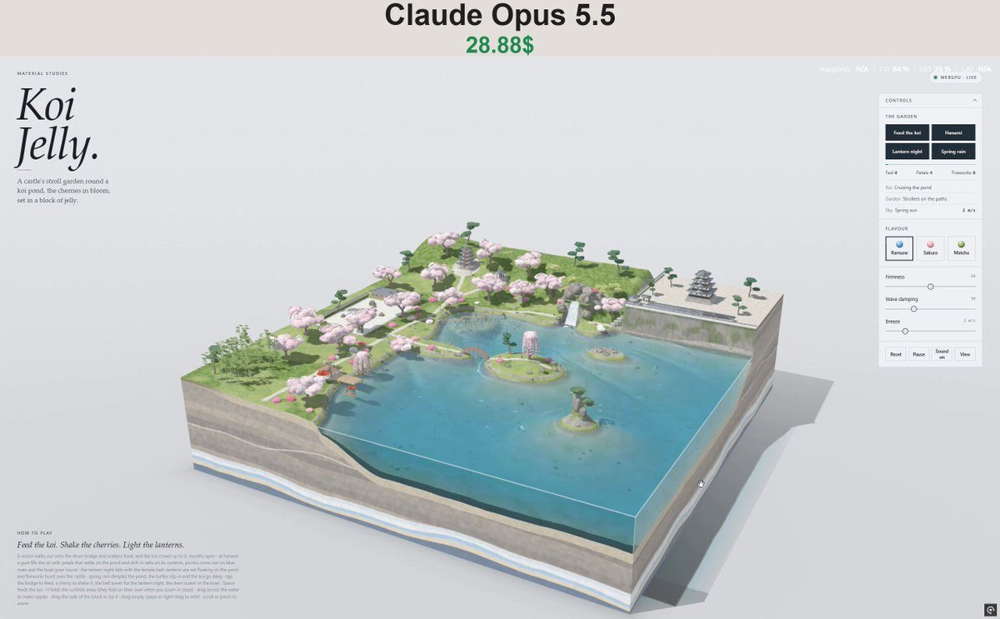

# 锦鲤果冻 Koi Jelly

- **类型**：交互网页 / 果冻微缩场景
- **技术栈**：WebGPU · WGSL · 浅水模拟 · 单文件 HTML
- **标签**：`webgpu` `wgsl` `浅水模拟` `果冻` `日式庭园` `material-studies` `vibe-coding` `ai-测试`
- **测试模型**：Claude Opus 5.5
- **来源**：[@vib3coded](https://x.com/vib3coded) · [原帖](https://x.com/vib3coded/status/2115484328234807385) · [提示词帖](https://x.com/vib3coded/status/2115484540487503872) · 2026-10-29（北京时间） · 试玩：[Claude Opus 5.5](https://claude.ai/artifact/5mWDpytJMa8ueCNdYUS7Km)

> 说明：这是 [@vib3coded](https://x.com/vib3coded) 公开分享的提示词（测试模型见上）。界面上的按钮、标题、提示语等文字按原提示词要求保持英文（引号里的英文原样保留）。优先使用英文原文；中文翻译附在后面。

---

## 效果



## 提示词（英文原文）

```text
Build a single-file interactive WebGPU diorama called "Koi Jelly" for a "Material Studies" series: a Japanese castle stroll garden around a koi pond, cut out as a square block of clear jelly standing on a pale paper-grey table. Plain JS + WGSL, no libraries, everything inline, no network requests.

SCENE (block ~5.2 × 5.2 units, water level ~1.0):
- The pond fills the front and right of the block; its cut faces show koi swimming through the jelly.
- Back right: a castle bailey on sheer dry-stone walls (ishigaki) rising straight out of the water, a white multi-tiered keep (tenshu) with dark tiled roofs and upturned eaves, a stone stair down to the paths.
- Back left: a five-storey pagoda on a hill and a bell tower with a big bronze bell.
- Between them: a waterfall pouring off a rocky knoll through a notch with a sheer face into a plunge pool, with foam and a current pushing out into the pond; maples and azaleas on the knoll.
- Left: a lawn and moss garden, a raked-gravel rock garden (karesansui), and a tea house with a veranda by the water, a red parasol (nodategasa) and red bench cloths. Stone lanterns (tōrō, yukimi-dōrō) along gravel paths, a deer-scarer (shishi-odoshi) that slowly fills, tips and knocks.
- A promontory leads to a red arched drum bridge (taiko-bashi) onto the big island: a weeping cherry with long pink strands, a snow-viewing lantern, a leaning pine.
- A zigzag plank bridge (yatsuhashi) crosses an iris marsh in a back cove. A crane island with tall rocks and a leaning pine; a turtle island with flat basking rocks.
- ~17 cherry trees in full bloom, azaleas, pines, maples, edging stones round the pond, a pebbly pond bed with algae.

WATER: a real-time shallow-water heightfield (~168² grid) with refraction, colour absorption, caustics on the bed, foam and ripples. Everything disturbs it: koi gulps, ducks, the boat, raindrops, the waterfall current. Drag on the water to stir it; drag on the ground to tilt the whole jelly block (it wobbles back).

LIFE:
- 16 koi in real varieties (kohaku, sanke, showa, yamabuki ogon, platinum, asagi, chagoi, tancho) with procedural patterns, cruising just under the surface and schooling loosely; little medaka.
- Pairs of mandarin ducks; a kingfisher that perches and dives; a grey heron that wades, strikes and flies between spots; Japanese white-eyes flitting in the blossom.
- Pond turtles that bask on rocks, slide in with a plop when startled, swim around the island and haul out again.
- People strolling the paths and crossing the bridges, a monk at the bell, a boatman poling a pleasure boat.

EVENTS (four main buttons):
1. Feed the koi (also Space, or tap the drum bridge): a visitor walks to the crown of the bridge and throws five handfuls of floating pellets; the koi crowd in, mouths open, and slurp every pellet (count shown).
2. Hanami: a gust shakes the cherries; hundreds of petals tumble and drift, gathering into petal rafts (hanaikada) on the water; picnic mats appear; the boat sets out. Tap any cherry to shake down a shower.
3. Lantern night (or tap the bell tower): dusk falls with a temple bell; paper lanterns are set afloat and drift on the current; stone lanterns light up with warm pools of light on the ground and water; rockets rise from behind the castle and burst as large coloured chrysanthemum shells that light the garden in their colour; dawn returns with the bell.
4. Spring rain: the sky greys, rain streaks and drop rings, the waterfall swells, strollers leave, the koi go deeper, distant thunder.

SOUND: synthesised with WebAudio, only for events (no constant ambience): pellets pattering, koi gulps, a koto phrase and wind for hanami, temple bell, rocket whistle, boom and crackle, lantern plink, the deer-scarer's knock, oar, kingfisher, duck, heron, plop, thunder. A rain loop plays only while it rains.

UI: a masthead (eyebrow "Material Studies", serif italic title "Koi Jelly.", a short description). A floating control panel at top right: the four event buttons, Reset, Pause, Sound on/off, View. Three status lines (koi / garden / sky) with tallies (koi fed, petals on the pond, fireworks) and an activity meter. Jelly palettes Ramune / Sakura / Matcha. Sliders for Firmness, Damping and Breeze (m/s). The panel folds to just its buttons (header or H key) and folds itself away when you zoom in close. Right-drag to orbit, wheel or pinch to zoom; a bottom sheet on phones; a polite fallback card when WebGPU is missing.

RENDERING: MSAA, a sun shadow map, a caustics pass, refraction from scene and depth textures, instanced creatures, soft studio lighting, a real night mode. Smooth at 60 fps.
```

---

## 提示词（中文）

为 "Material Studies"（材料研究）系列构建一个名为 "Koi Jelly"（锦鲤果冻）的单文件交互式 WebGPU 微缩场景：一座围绕锦鲤池的日本城郭回游式庭园，被切成一块方形的透明果冻，立在浅纸灰色的桌面上。纯 JS + WGSL，不用库，所有东西内联，不发任何网络请求。

### 场景（方块约 5.2 × 5.2 单位，水位约 1.0）

- 池塘占据方块的前部和右侧；切面上能看到锦鲤在果冻里游。
- 右后方：一座城郭曲轮，建在直接从水中拔起的陡峭干砌石墙（石垣，ishigaki）上；一座白色的多层天守（tenshu），深色瓦顶，翘起的屋檐；一道石阶通向下方的小路。
- 左后方：小山上的一座五重塔，以及一座挂着大铜钟的钟楼。
- 两者之间：一道瀑布从岩石小丘上经过一个陡峭的缺口倾泻进潭里，带泡沫，水流推进池塘；小丘上有枫树和杜鹃。
- 左侧：草坪和苔庭，一座耙纹砂石的枯山水（karesansui），以及一座临水带檐廊的茶室，有红色野点伞（nodategasa）和红色长凳布。砂石小路两旁有石灯笼（tōrō、雪见灯笼 yukimi-dōrō），还有一个慢慢灌满、倾倒、再敲响的惊鹿（shishi-odoshi）。
- 一个岬角通向一座红色拱形太鼓桥（taiko-bashi），连到大岛上：一棵垂着长长粉色枝条的垂樱、一盏雪见灯笼、一棵斜松。
- 一座之字形木板桥（八桥，yatsuhashi）横跨后方小湾里的鸢尾湿地。一座鹤岛，有高耸的岩石和一棵斜松；一座龟岛，有平坦的晒背石。
- 约 17 棵盛开的樱花树，杜鹃、松树、枫树，池边的护岸石，池底是长着藻类的卵石。

### 水

实时浅水高度场（约 168² 网格），带折射、颜色吸收、池底焦散、泡沫和涟漪。所有东西都会扰动它：锦鲤吞吃、鸭子、小船、雨滴、瀑布水流。在水面上拖动可以搅水；在地面上拖动会让整块果冻倾斜（然后晃回来）。

### 生物

- 16 条锦鲤，真实品种（红白、大正三色、昭和三色、山吹黄金、白金、浅黄、茶鲤、丹顶），花纹程序化生成，在水面下巡游，松散地成群；还有小小的青鳉。
- 成对的鸳鸯；一只会停栖并俯冲入水的翠鸟；一只苍鹭在水里涉行、出击，并在几个地点之间飞来飞去；绣眼鸟在花间穿梭。
- 池龟在石头上晒背，受惊时扑通滑进水里，绕着岛游一圈，再爬上来。
- 游人在小路上散步、过桥，一位僧人在钟旁，一位船夫撑着游船。

### 事件（四个主按钮）

1. Feed the koi（喂锦鲤；也可以按空格，或点太鼓桥）：一位游客走到桥顶，撒出五把漂浮饲料；锦鲤蜂拥而来，张大嘴，把每一粒都吸掉（显示数量）。
2. Hanami（赏花）：一阵风摇动樱花树；成百上千的花瓣翻滚飘落，在水面上聚成花筏（hanaikada）；野餐垫出现；小船出发。点任意一棵樱花树可以摇下一阵花雨。
3. Lantern night（灯笼之夜；或点钟楼）：伴着寺钟声天色转暗；纸灯笼被放到水上，随水流漂动；石灯笼亮起，在地面和水面投下温暖的光晕；烟花从城郭后面升起，炸成大朵彩色菊花弹，用各自的颜色照亮庭园；随着钟声天又亮了。
4. Spring rain（春雨）：天空变灰，雨丝和雨滴圈纹，瀑布水量变大，游人离开，锦鲤潜得更深，远处有雷声。

### 声音

用 WebAudio 合成，只在事件时发声（没有持续的环境音）：饲料噼啪落水、锦鲤吞吃、赏花时的一段古筝乐句和风声、寺钟、烟花的呼啸、爆炸和噼啪声、灯笼的叮声、惊鹿的敲击声、船桨、翠鸟、鸭子、苍鹭、扑通声、雷声。雨声循环只在下雨时播放。

### 界面

- 刊头（小标题 "Material Studies"，衬线斜体大标题 "Koi Jelly."，一段简短描述）。
- 右上角一个浮动控制面板：四个事件按钮、Reset、Pause、Sound on/off、View。三行状态（koi / garden / sky：锦鲤 / 庭园 / 天空），带计数（喂过的锦鲤、池面花瓣数、烟花数）和一个活跃度指示条。
- 果冻配色 Ramune / Sakura / Matcha（波子汽水 / 樱花 / 抹茶）。滑块：Firmness、Damping、Breeze (m/s)（硬度、阻尼、微风风速）。
- 面板可以收起到只剩按钮（点标题或按 H 键），镜头拉近时会自动收起。右键拖动环绕，滚轮或双指缩放；手机上改为底部抽屉；没有 WebGPU 时显示一张礼貌的降级卡片。

### 渲染

MSAA、太阳阴影贴图、焦散通道、基于场景和深度纹理的折射、实例化生物、柔和的摄影棚光照、真正的夜间模式。稳定 60 fps。
