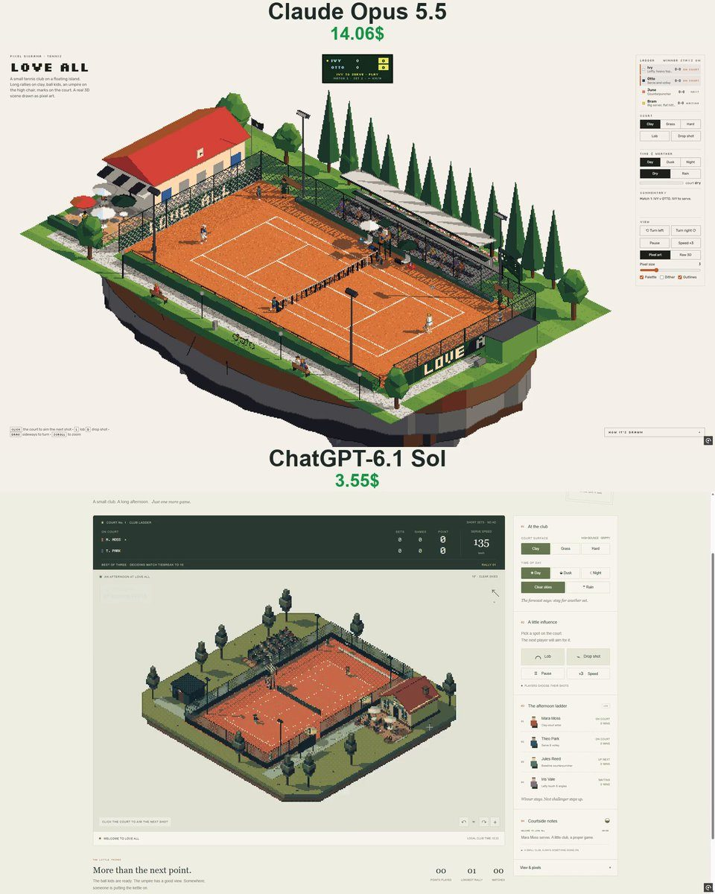

# 网球俱乐部 Love All

- **类型**：交互网页 / 像素风场景
- **技术栈**：three.js · 像素后处理 · 网球物理
- **标签**：`three.js` `像素风` `网球` `体育模拟` `vibe-coding` `ai-测试`
- **测试模型**：Claude Opus 5.5 vs GPT-6.1 Sol
- **来源**：[@vib3coded](https://x.com/vib3coded) · [原帖](https://x.com/vib3coded/status/2114758798845841679) · [提示词帖](https://x.com/vib3coded/status/2114759030795329913) · 2026-10-27（北京时间） · 试玩：[Claude Opus 5.5](https://claude.ai/artifact/LgfUeCo8K7CvXqsFxugSzc) · [GPT-6.1 Sol](https://love-all-rosy.vercel.app/)

> 说明：这是 [@vib3coded](https://x.com/vib3coded) 公开分享的提示词（测试模型见上）。界面上的按钮、标题、提示语等文字按原提示词要求保持英文（引号里的英文原样保留）。优先使用英文原文；中文翻译附在后面。

---

## 效果



## 提示词（英文原文）

```text
Make a pixel-art 3D diorama of a small tennis club on a floating island, the same series and engine as my other pixel dioramas (three.js, orthographic isometric camera turned in quarter steps, a small render target with no anti-aliasing snapped to whole pixels, depth-based outlines, a fixed 64-colour palette matched in OKLab, hard sun shadows, day/dusk/night, rain with puddle reflections). Call it "Love All".

The club: one court inside a chain-link fence with low dark-green windscreens reading LOVE ALL, a net that sags from 1.07 m at the posts to 0.914 m at the strap, the umpire's high chair with a sunshade and the players' chairs with parasols, a three-row stand, a clubhouse with a red roof, a clock showing the real time, a flag and a terrace, a groundsman's shed, floodlights (spotlights aimed at the court, so night stays dark around it), poplars and a gravel path. The court can be clay, grass or a hard court, painted to the rule book.

Real ball physics: gravity, drag and the Magnus force of topspin and slice; a different bounce on each surface; net cords that trickle over or drop back. Players predict the ball's flight, pick where the strings can meet it (after the bounce, or on the volley or smash at the net), run there and swing in time. Each figure is a rig of boxes posed with two-bone IK; the racket follows keyed paths for a forehand, a two-handed backhand, a volley, a smash and a serve with toss, trophy pose and jump, and the strings meet the ball at contact. Shot choice comes from the situation (cross court, down the line, sharp angle, slice when stretched, lob or pass against a net rusher, drop shot against a deep player, approach and volley). Each launch is solved to clear the net and land on its target, then thrown a little off, so winners, errors and long rallies come out of the physics. Four players with their own styles play a ladder where the winner stays on: short sets to four games, no-ad scoring, a tiebreak at 3–3 and a match tiebreak to ten.

Life on court: ball kids fetch dead balls and bounce a new one to the server, who bounces it before serving. The umpire watches the ball and calls the score. On clay the ball leaves marks, and on close calls the umpire climbs down to read the mark. Between sets the groundsmen drag the clay; grass wears behind the baselines. In rain the players sit under their parasols and the groundsmen pull a cover over the court. Spectators follow the ball and clap. Click the court to aim the next shot, with buttons for a lob or a drop shot, and a ×3 speed toggle. Show a tennis scoreboard (sets, point, server, serve speed) and the ladder; English UI; it must work on phones.
```

---

## 提示词（中文）

做一个像素风 3D 微缩场景：浮空岛上的一个小网球俱乐部，与我其他像素微缩场景同一系列、同一引擎（three.js，正交等距相机按 90° 旋转，小尺寸渲染目标、不抗锯齿、吸附到整像素，基于深度的描边，固定 64 色调色板（在 OKLab 空间匹配），硬阴影，白天 / 黄昏 / 夜晚，下雨时有水洼倒影）。命名为 "Love All"。

### 俱乐部

一片球场，围在铁丝网里，网上挂着写有 LOVE ALL 的矮墨绿色挡风布；球网从网柱处的 1.07 m 下垂到中间网带处的 0.914 m；裁判高椅带遮阳篷，球员椅带遮阳伞；三排看台；一座红顶会所，挂着显示真实时间的钟、一面旗和一个露台；场地管理员的小棚；泛光灯（聚光灯对准球场，所以夜里球场周围保持黑暗）；杨树和一条砾石小路。球场可以是红土、草地或硬地，按规则书画线。

### 真实的球体物理

重力、阻力，以及上旋和切削带来的马格努斯力；不同场地弹跳不同；擦网后可能慢慢滚过去，也可能落回来。

### 球员

- 球员会预判球的飞行，选择拍线能接到球的位置（弹地之后，或在网前截击 / 高压），跑过去并按时挥拍。
- 每个人物都是用双骨骼 IK 摆姿势的方块骨架；球拍沿预设的关键帧路径挥动：正手、双手反手、截击、高压，以及带抛球、"奖杯姿势"和起跳的发球；接触瞬间拍线正好碰到球。
- 击球选择取决于局面（斜线、直线、大角度、被调动时切削、对上网者放高球或穿越、对站得很深的对手放小球、随球上网截击）。每次出球都通过求解保证过网并落到目标点，然后再稍稍偏一点，所以制胜分、失误和长回合都是物理自然产生的。
- 四位风格各异的球员打擂台赛，赢者留场：短盘制（先赢四局），无占先计分，3–3 时抢七，决胜盘为抢十。

### 场上的生活

球童捡死球，把新球弹给发球方，发球方拍几下再发。裁判盯着球并报分。红土上球会留下印记，判罚接近时裁判会爬下来看印记。盘间场地管理员拖平红土；草地在底线后方会磨秃。下雨时球员坐在遮阳伞下，场地管理员把雨布拉过球场。观众视线跟着球走并鼓掌。

### 界面

点击球场可以指定下一球的落点，另有放高球和放小球的按钮，以及一个 ×3 倍速开关。显示网球记分板（盘分、分数、发球方、发球速度）和擂台排位；界面用英文；必须能在手机上运行。
