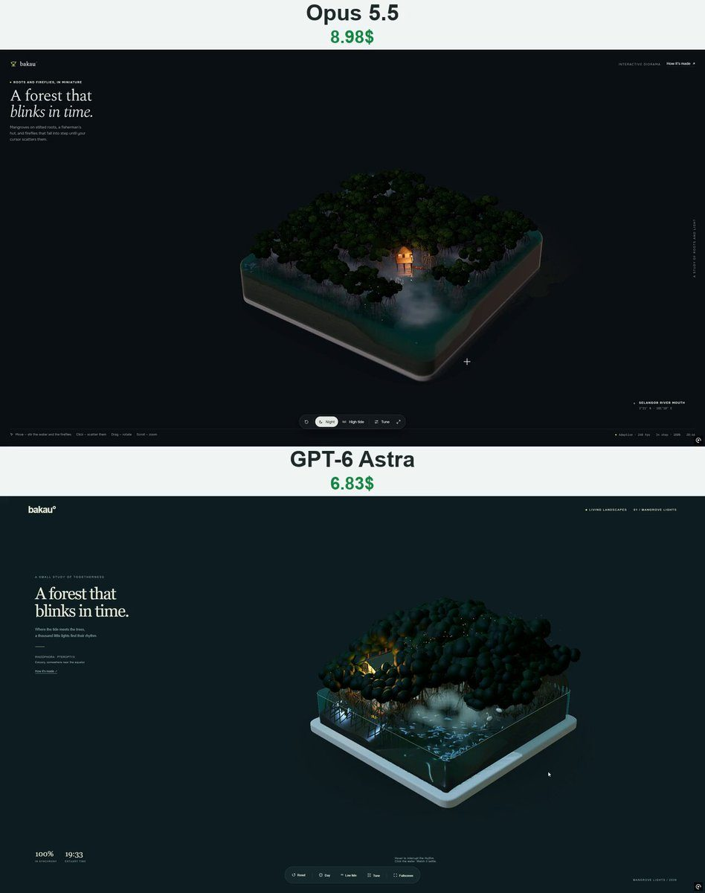

# 红树林之光 Mangrove Lights

- **类型**：交互网页 / 3D 微缩场景
- **技术栈**：three.js r160 · WebGL · 水体着色器 · 单文件 HTML
- **标签**：`three.js` `webgl` `水体` `萤火虫` `kuramoto` `vibe-coding` `ai-测试`
- **测试模型**：Claude Opus 5.5 vs ChatGPT-6 Astra
- **来源**：[@vib3coded](https://x.com/vib3coded) · [原帖](https://x.com/vib3coded/status/2116024691533979940) · [提示词帖](https://x.com/vib3coded/status/2116024829639881137) · 2026-10-30（北京时间） · 试玩：[Claude Opus 5.5](https://claude.ai/artifact/BqtUsLh9EupyV2mdxX47dK) · [ChatGPT-6 Astra](https://mangrove-lights-vibecoded1.vercel.app/)

> 说明：这是 [@vib3coded](https://x.com/vib3coded) 公开分享的提示词（测试模型见上）。界面上的按钮、标题、提示语等文字按原提示词要求保持英文（引号里的英文原样保留）。优先使用英文原文；中文翻译附在后面。

---

## 效果



## 提示词（英文原文）

```text
Build a single-file interactive WebGL diorama called "Mangrove Lights" (Three.js r160 via import map, OrbitControls, no external models or textures, English UI). A mangrove island sits inside a rounded rectangular block of water, about 10×10 units and 1.7 deep, on a cream plinth, over a transparent canvas with a soft contact shadow.

Island: a procedural heightfield with a dry forest floor at the back, shallow mud flats, creeks, and an open inlet at the front corner. Mangrove fringes stand in about 0.5 of water along both glass walls that face the camera, so the stilt roots show above the water and through the glass. The terrain's side walls are a layered mud cross-section with root fibres. Mud below the high-tide line stays dark, wet and glossy.

Trees (about 140): each has a short trunk; 8–11 arching prop roots built as CatmullRom tube geometry that reach into the mud; hanging aerial roots; and a dense crown of displaced icosphere blobs with per-instance AO and dark glossy greens. Bark is algae- and barnacle-stained below the high-tide line. Add pencil-root pneumatophores on the flats, a fisherman's hut on stilts with a lit window and lamp plus a boardwalk, a canoe that bobs on the waves, wading egrets, an egret flying by day, and schools of silver fish that swim between the roots and flee the cursor.

Water: refraction, Beer–Lambert absorption from real thickness, Fresnel sky, screen-space reflections, sun glints, and almost no shore foam. A 256² GPU wave-equation ripple sim responds to the cursor and clicks. Low mist layers part around the cursor.

Fireflies: about 1600 Kuramoto oscillators around the crowns, coupled to a local spatial-hash mean field plus the global field, with a position-dependent phase offset so the synchronized flash sweeps across the forest as a wave. Use an asymmetric flash curve and additive point sprites drawn after the water, with a manual depth test. Mirrored copies show reflections on the water. Two point lights pulse with the average glow. The cursor randomizes the phase of nearby fireflies and pushes them away; a click scatters a wider area; they drift home and resync.

Lighting: day/night palettes with moonlight, a warm hut lamp, ACES tone mapping and tilt-shift.

UI: brand "bakau°"; headline "A forest that blinks in time."; dock buttons Reset, Night/Day, High/Low tide, Tune and Fullscreen; a settings panel (time, fireflies, pull to sync, mist, water color, tide, waves, ripples, clarity, light azimuth, tilt-shift); a live sync % and clock; a "How it's made" note. The page theme turns dark at night. Include adaptive DPR, a low-detail mode for touch devices, reduced-motion support and a WebGL2 fallback.
```

---

## 提示词（中文）

构建一个名为 "Mangrove Lights"（红树林之光）的单文件交互式 WebGL 微缩场景（Three.js r160，通过 import map 引入，OrbitControls，不用外部模型或贴图，界面用英文）。一座红树林小岛放在一块圆角矩形的水体里，大约 10×10 个单位、1.7 深，下面是奶油色底座，背景是透明画布，带柔和的接触阴影。

### 小岛

程序化高度场：后方是干燥的林地，然后是浅浅的泥滩、潮沟，前角是一个敞开的小海湾。沿着朝向相机的两面玻璃墙，红树林边缘站在约 0.5 深的水里，所以支柱根（stilt roots）既露出水面，也能透过玻璃看到。地形的侧壁是分层的泥土剖面，带根须纤维。高潮线以下的泥保持深色、湿润、有光泽。

### 树（约 140 棵）

- 每棵树一段短树干；8–11 条拱形支柱根，用 CatmullRom 管道几何体构建，扎进泥里；垂挂的气生根；一个由位移过的 icosphere 团块组成的茂密树冠，带逐实例 AO 和深色有光泽的绿色。
- 高潮线以下的树皮带着藻类和藤壶的痕迹。
- 泥滩上加铅笔状的呼吸根（pneumatophores）；一座高脚渔夫小屋，窗户亮着灯、挂着灯，外加一条木栈道；一只随浪起伏的独木舟；涉水的白鹭，白天还有一只白鹭飞过；一群群银色小鱼在根之间穿游，会躲开光标。

### 水

折射、按真实厚度计算的 Beer–Lambert 吸收、菲涅尔天空、屏幕空间反射（SSR）、阳光闪点，岸边几乎没有泡沫。一个 256² 的 GPU 波动方程涟漪模拟，响应光标和点击。低矮的雾层会在光标周围分开。

### 萤火虫

- 树冠周围约 1600 个 Kuramoto 振子，耦合到局部空间哈希平均场加上全局场，并带一个与位置相关的相位偏移，让同步闪光像波浪一样扫过整片森林。
- 使用不对称的闪光曲线，加法混合的点精灵在水之后绘制，手动做深度测试。镜像副本显示水面倒影。两盏点光源随平均亮度脉动。
- 光标会打乱附近萤火虫的相位并把它们推开；点击会驱散更大一片；它们会飘回原处并重新同步。

### 光照

白天 / 夜晚两套配色，月光，小屋温暖的灯光，ACES 色调映射和移轴（tilt-shift）效果。

### 界面

- 品牌名 "bakau°"；大标题 "A forest that blinks in time."。
- 底部按钮：Reset、Night/Day、High/Low tide、Tune、Fullscreen（重置、夜 / 昼、涨潮 / 退潮、调节、全屏）。
- 设置面板：time、fireflies、pull to sync、mist、water color、tide、waves、ripples、clarity、light azimuth、tilt-shift（时间、萤火虫数量、同步拉力、雾、水色、潮位、波浪、涟漪、清澈度、光照方位角、移轴）。
- 实时同步百分比和时钟；一段 "How it's made" 说明。夜间页面主题变暗。
- 包含自适应 DPR、触屏设备的低细节模式、减少动态效果（reduced-motion）支持，以及 WebGL2 降级方案。
