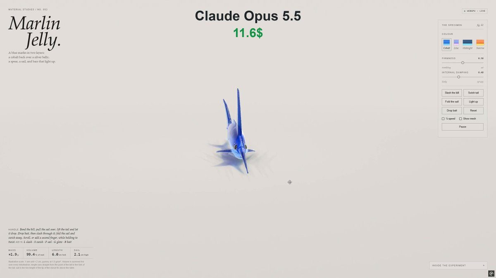

# 果冻蓝枪鱼 Marlin Jelly

- **类型**：交互网页 / 软体果冻
- **技术栈**：WebGPU · XPBD 四面体软体 · SDF
- **标签**：`webgpu` `xpbd` `果冻` `枪鱼` `vibe-coding` `ai-测试`
- **测试模型**：Claude Opus 5.5
- **来源**：[@vib3coded](https://x.com/vib3coded) · [原帖](https://x.com/vib3coded/status/2115752978946687084) · [提示词帖](https://x.com/vib3coded/status/2115753197432094802) · 2026-10-29（北京时间） · 试玩：[Claude Opus 5.5](https://claude.ai/artifact/4z8xyB3PH12MufDaKLPhLa)

> 说明：这是 [@vib3coded](https://x.com/vib3coded) 公开分享的提示词（测试模型见上）。界面上的按钮、标题、提示语等文字按原提示词要求保持英文（引号里的英文原样保留）。优先使用英文原文；中文翻译附在后面。

---

## 效果



## 提示词（英文原文）

```text
Make an interactive WebGPU soft-body jelly study of a blue marlin (XPBD tetrahedral soft body, SDF geometry, surface-nets render meshes, two jelly layers, refraction and Beer–Lambert absorption), in the style of the jelly whale and hammerhead studies. Anatomy: tall narrow body with a high nape, slim raised tail stalk with caudal keels, a long tapered round bill with a shorter lower jaw, a big eye; a tall raked sail of a front dorsal lobe running into a low crest, second dorsal and anal finlets, first anal fin, long sickle pectorals, thin pelvic spikes, and a high crescent tail — all from one fin recipe with convex leading and falcate trailing edges. Clear cobalt jelly over a milky silver belly with an angle-dependent sheen, dark back and fins as a pigment film, about fifteen flank bars made of spots and dashes, fin rays, gill cover, gape, nostrils and lateral line as normal bumps. Muscle-strain actions: tail swish, a quick side-to-side bill slash through beads of bait, folding/raising the sail by squashing its tets vertically with volume kept, and a "light up" mode where the bars glow electric blue (also flashing with each slash/swish). Palettes Cobalt, Lilac, Midnight, Sunrise; live readouts for mass, volume, bill-to-fork length and sail height; English UI.
```

---

## 提示词（中文）

做一个交互式 WebGPU 软体果冻研究：一条蓝枪鱼（XPBD 四面体软体，SDF 几何，surface-nets 渲染网格，两层果冻，折射和 Beer–Lambert 吸收），风格与果冻鲸、果冻双髻鲨那几件相同。

- 解剖结构：高而窄的身体，颈背高耸；细长抬起的尾柄，带尾龙骨；长而渐尖的圆形吻，下颌更短；一只大眼睛；前背鳍是一面高大后倾的"帆"，延伸成一道低矮的脊；第二背鳍和臀鳍小鳍、第一臀鳍、长长的镰刀状胸鳍、细细的腹鳍刺，以及高高的新月形尾鳍——全部用同一个鳍的配方生成：前缘外凸、后缘呈镰形。
- 透明的钴蓝色果冻，包着乳白银色的腹部，带随角度变化的光泽；深色的背和鳍用一层色素膜表现；体侧约十五道由斑点和短划组成的横条；鳍条、鳃盖、嘴裂、鼻孔和侧线用法线凹凸表现。
- 肌肉应变动作：甩尾；用吻快速左右一挥，划过一串诱饵珠子；通过竖向压扁帆鳍的四面体（保持体积）来收起 / 竖起帆鳍；以及一个 "light up"（点亮）模式，让横条发出电光蓝（每次挥吻 / 甩尾时也会闪一下）。
- 配色 Cobalt、Lilac、Midnight、Sunrise（钴蓝、淡紫、午夜、日出）；实时读数：质量、体积、吻端到尾叉长度和帆鳍高度；界面用英文。
