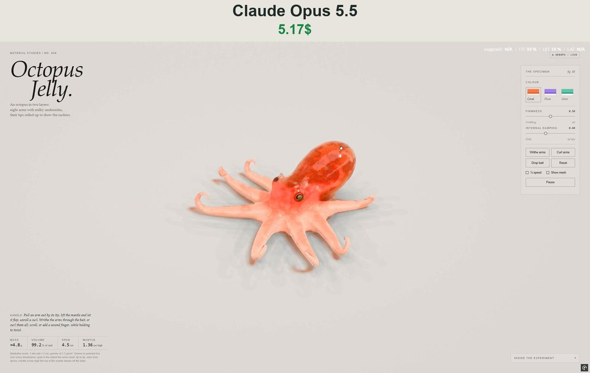

# 双层果冻章鱼 Octopus Jelly (Two-Layer)

- **类型**：交互网页 / 软体果冻
- **技术栈**：WebGPU · XPBD 四面体软体
- **标签**：`webgpu` `xpbd` `果冻` `章鱼` `vibe-coding` `ai-测试`
- **测试模型**：Claude Opus 5.5
- **来源**：[@vib3coded](https://x.com/vib3coded) · [原帖](https://x.com/vib3coded/status/2115173334031737112) · [提示词帖](https://x.com/vib3coded/status/2115173563669864948) · 2026-10-28（北京时间） · 试玩：[Claude Opus 5.5](https://claude.ai/artifact/73duwb2ucpGAKiMZjCsM6M)

> 说明：这是 [@vib3coded](https://x.com/vib3coded) 公开分享的提示词（测试模型见上）。界面上的按钮、标题、提示语等文字按原提示词要求保持英文（引号里的英文原样保留）。优先使用英文原文；中文翻译附在后面。

---

## 效果



## 提示词（英文原文）

```text
Make an interactive WebGPU soft-body study of an octopus cast in two layers of jelly, in the same studio style as the tiger shark jelly: a domed head with eyes in raised sockets (golden iris, horizontal bar pupil) and a small horn over each, a big soft mantle leaning back, a funnel on the flank, and a web joining eight arms. Each arm is a chain of tapering capsules laid out by integrating curvature: a gentle sweep across the table, then the outer third rolls up off the table into a curl so the two staggered rows of pale suckers face out. The underside of every arm is a milky layer, the back has a chromatophore mottle and small papillae. XPBD tetrahedral sim with firmer arm tips; muscle strain makes the arms writhe (sideways bending waves out along each arm, phased arm to arm) and curl up and let go. Drag to stretch and lift, drop bait beads, three colourways (coral, plum, mint), live mass, volume, arm span and mantle height readouts.
```

---

## 提示词（中文）

做一个交互式 WebGPU 软体研究：一只用两层果冻浇铸成的章鱼，摄影棚风格与虎鲨果冻那件相同。

- 圆顶形的头，眼睛在凸起的眼窝里（金色虹膜、水平条形瞳孔），每只眼上方有一个小角；一个向后仰的大而柔软的外套膜；侧面一个漏斗；八条腕之间连着一层膜（web）。
- 每条腕是一串逐渐变细的胶囊体，按曲率积分来排布：先在桌面上轻轻扫开，然后外侧三分之一离开桌面卷起来，让两排交错的浅色吸盘朝外。
- 每条腕的下侧是一层乳白色的果冻，背面有色素细胞斑驳纹理和细小的乳突。
- XPBD 四面体模拟，腕尖更硬；肌肉应变让腕扭动（沿每条腕向外传播的侧向弯曲波，各腕之间有相位差），会卷起再松开。
- 拖动可以拉伸和提起，可以投放诱饵珠子；三种配色 coral、plum、mint（珊瑚、梅子、薄荷）；实时读数：质量、体积、腕展和外套膜高度。
