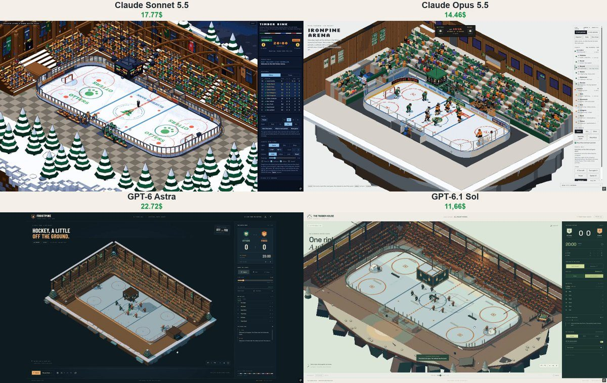

# 像素冰球馆 Pixel Ice Hockey Arena

- **类型**：交互网页 / 像素风场景
- **技术栈**：three.js · 像素后处理 · 冰球规则模拟
- **标签**：`three.js` `像素风` `冰球` `体育模拟` `vibe-coding` `ai-测试`
- **测试模型**：Claude Sonnet 5.5 vs Claude Opus 5.5 vs ChatGPT-6 Astra vs GPT-6.1 Sol
- **来源**：[@vib3coded](https://x.com/vib3coded) · [原帖](https://x.com/vib3coded/status/2115834230055850295) · [提示词帖](https://x.com/vib3coded/status/2115834375862456500) · 2026-10-29（北京时间） · 试玩：[Claude Opus 5.5](https://claude.ai/artifact/StpjpiYymsrnBBTBgi8qSz) · [Claude Sonnet 5.5](https://claude.ai/artifact/HCF658GZJvW4vDRVSu1dC9) · [ChatGPT-6 Astra](https://frostpine-hockey-astra.vercel.app) · [GPT-6.1 Sol](https://timber-house-hockey.vercel.app/)

> 说明：这是 [@vib3coded](https://x.com/vib3coded) 公开分享的提示词（测试模型见上）。界面上的按钮、标题、提示语等文字按原提示词要求保持英文（引号里的英文原样保留）。优先使用英文原文；中文翻译附在后面。

---

## 效果



## 提示词（英文原文）

```text
Make a 3D pixel-art ice hockey game: an old timber indoor arena on a floating slab of frozen ground, rendered as a real-time three.js scene through a low-res orthographic isometric camera with depth outlines and a 64-colour OKLab palette; quarter-turn rotation where the two walls/stands nearest the camera lift away like a doll's house. Five skaters and a goalie a side (home Otters in green, visiting Foxes in orange), box-rig players with IK, numbers on their backs, helmets with visors, sticks laid from blade to top hand. Real rules: three 20-minute periods on a four-sided scoreboard hung over centre ice (clock runs only in play), faceoffs at the correct dots with a striped referee dropping the puck, goalie freezes for whistles, two-minute penalties in a glassed penalty box with power plays, body checks into the boards that rattle the glass, pucks over the glass into the crowd, sudden-death overtime, goal horn and red light, fist bumps along the bench, a handshake line at the end. Momentum skating with hockey stops, five-role team shape, passes solved from ice friction, shots aimed at the open corner. The ice is a canvas the skates scratch; between periods a resurfacer drives laps from its corridor and wipes it clean. Instanced crowd of ~900 fans who stand for goals, groan at posts and do the wave; lights Game / Dim / Show (spotlights and phone lights). Side panel with live score, clock, rosters, press-box commentary and controls. Original fictional teams, sponsors and town; English UI.
```

---

## 提示词（中文）

做一个 3D 像素风冰球游戏：一座老式木结构室内冰场，坐落在一块漂浮的冻土板上，用实时 three.js 场景渲染，镜头是低分辨率正交等距相机，带深度描边和 64 色 OKLab 调色板；可以按 90° 旋转视角，离相机最近的两面墙 / 看台会像玩偶屋一样掀起移开。

- 每队五名滑手加一名守门员（主队 Otters 水獭队穿绿色，客队 Foxes 狐狸队穿橙色）；方块骨架球员，带 IK，背后有号码，戴带面罩的头盔，球杆从杆刃一直摆到上手的位置。
- 真实规则：三节，每节 20 分钟，四面记分牌悬挂在中圈上方（只在比赛进行时走表）；在正确的争球点争球，由穿条纹衣的裁判丢下冰球；守门员压住球会吹哨；两分钟小罚，进玻璃罚球席，形成以多打少；把人撞向界墙会震得玻璃哗哗响；冰球飞过玻璃落进观众席；突然死亡加时赛；进球号角和红灯；替补席上一路碰拳；结束时双方排队握手。
- 带惯性的滑行和冰球式急停，五个位置角色的阵型，传球根据冰面摩擦求解，射门瞄准空出来的角落。
- 冰面是一块会被冰刀划出痕迹的画布；节间休息时，浇冰车从通道开出来绕圈，把冰面擦干净。
- 约 900 名观众用实例化渲染，进球时起立，打中门柱时一起叹气，还会做人浪；灯光模式 Game / Dim / Show（比赛 / 昏暗 / 表演：聚光灯和手机闪光灯）。
- 侧边面板：实时比分、时钟、名单、记者席解说和控制项。原创虚构的球队、赞助商和小镇；界面用英文。
