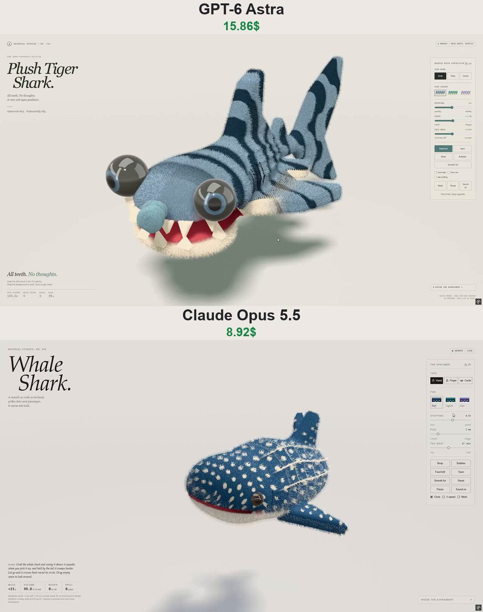

# 毛绒鲸鲨 Plush Whale Shark

- **类型**：交互网页 / 毛绒软体
- **技术栈**：WebGPU · 毛发壳层 · XPBD 软体
- **标签**：`webgpu` `毛绒` `鲸鲨` `xpbd` `material-studies` `vibe-coding` `ai-测试`
- **测试模型**：Claude Opus 5.5 vs ChatGPT-6 Astra
- **来源**：[@vib3coded](https://x.com/vib3coded) · [原帖](https://x.com/vib3coded/status/2114375468870766954) · [提示词帖](https://x.com/vib3coded/status/2114375731572592760) · 2026-10-25（北京时间） · 试玩：[Claude Opus 5.5](https://claude.ai/artifact/LhawN3EtyoM4ep2HawyyQt) · [ChatGPT-6 Astra](https://plush-tiger-shark.vercel.app/)

> 说明：这是 [@vib3coded](https://x.com/vib3coded) 公开分享的提示词（测试模型见上）。界面上的按钮、标题、提示语等文字按原提示词要求保持英文（引号里的英文原样保留）。优先使用英文原文；中文翻译附在后面。

> ⚠️ 注意：原帖文案写的是 "plush tiger shark"（毛绒虎鲨），但作者贴出的提示词是毛绒鲸鲨（Plush Whale Shark，No. 040）。效果图里 Opus 5.5 的版本是鲸鲨，Astra 的版本是虎鲨。提示词按原帖收录。

---

## 效果



## 提示词（英文原文）

```text
Build an interactive WebGPU artifact: a plush whale shark, as entry No. 040 in my "Material Studies" series. Start from the code of my Derp Beluga artifact (https://claude.ai/code/artifact/1855b66d-76ea-425d-95f2-01ff8e8ba2a1): read the whole page and keep its engine, page layout, typography, studio lighting, real-time fur shells, XPBD soft-body solver, finger and comb tools, sounds and UI as they are. Change only the animal.

Shape (one signed distance field, swimming toward +z):
- Broad, flat head: the front half of a squashed dome, squarer than an ellipse seen from above (superellipse in plan, n ≈ 2.4), about 1.5× wider than tall.
- Mouth: a real slit cut right across the front of the head, nearly the full head width, slightly below the midline. The lower jaw opens on a hinge (drawn, not simulated) to show a pink felt lining that darkens toward the throat.
- Two small glossy dark-brown bead eyes on the sides, just behind and above the mouth corners; trim the fur short around them.
- The back humps a little behind the head, then tapers into a narrow tail stock, with three soft ridges along each flank.
- Fins: large sickle pectorals angled out, down and back; a tall swept first dorsal at mid-back; a small second dorsal; a tall upright crescent tail with the upper lobe longer.
- Swimming: a side-to-side travelling wave (not up-and-down like the beluga), slow tempo (about 27 beats per minute by default).

Print and stitching (computed per fragment in the fur shaders):
- Dark back, pale cream belly panel whose top edge is the lower lip at the front.
- Whale-shark checkerboard: cream polka dots in staggered columns along the body and rows around it, smaller and denser on the head; thin pale pinstripes between the columns behind the head; pale piping along the three ridges. Measure along the head by surface arc length so the head spots stay round.
- Smaller spots on the flat faces of the fins, not around their edges.
- Each fur strand takes the colour under its root, so the spots have soft furry edges.
- Embroidery: five curved gill slits behind each eye, a small upturned curl at each mouth corner, and pink blush cheeks that deepen when it is happy.
- Palettes: Reef (blue-grey), Lagoon (teal), Lilac (lavender with butter-yellow spots); the swatch chips show dots.

Behaviour and UI (buttons: Boop, Bubbles, Feed krill, Yawn):
- Feed krill: a cloud of felt krill appears ahead; it turns toward it with its mouth wide open and sieves the cloud in (the cloud is drawn into the mouth and shrinks), then gulps.
- Yawn: a slow, enormous gape, held, then shut, with a low hum.
- Bubbles: felt bubbles blown from the mouth that wobble upward and pop; it also blows them now and then on its own.
- Boop: the loosely stuffed snout dents and wobbles back with a squeak; a finger boop on the snout makes it blush and wiggle.
- Keys: G wiggle, D dash, Y yawn, U bubbles. Readouts: mass, volume, boops, krill gulps.
- Rewrite all copy, hints and the notes panel for the whale shark; title "Plush Whale Shark"; new favicon and description.

Before publishing, render it in headless Chromium (WebGPU via SwiftShader, capturing the canvas with toDataURL) from the side, front and top and during feeding, and fix anything that looks wrong. Publish it as a new artifact.
```

---

## 提示词（中文）

构建一个交互式 WebGPU 作品：一只毛绒鲸鲨，作为我 "Material Studies" 系列的第 040 号。以我的 Derp Beluga（呆萌白鲸）作品的代码为起点（原帖链接见英文原文）：读完整个页面，保留它的引擎、页面布局、字体排版、摄影棚光照、实时毛发壳层（fur shells）、XPBD 软体求解器、手指和梳子工具、音效和界面，保持原样。只换动物。

### 形状（一个有符号距离场，朝 +z 方向游）

- 宽而扁的头：一个压扁穹顶的前半部分，从上方看比椭圆更方（平面上是超椭圆，n ≈ 2.4），宽约为高的 1.5 倍。
- 嘴：一道真正切开、横贯头部前方的裂口，几乎与头同宽，略低于中线。下颌绕铰链张开（画出来，不做模拟），露出粉色毛毡内衬，越往喉咙越深。
- 两侧各一颗小小的、有光泽的深棕色珠子眼睛，在嘴角稍后上方；眼睛周围的毛剪短。
- 背部在头后面稍微隆起，然后收窄成细细的尾柄，每侧体侧有三道柔和的纵脊。
- 鳍：大大的镰刀状胸鳍，向外、向下、向后伸；背中部一个高高后掠的第一背鳍；一个小的第二背鳍；一个高高竖立的新月形尾鳍，上叶更长。
- 游动：左右方向的行波（不像白鲸那样上下摆），节奏缓慢（默认每分钟约 27 拍）。

### 花纹与缝线（在毛发着色器里逐片元计算）

- 深色背部，浅奶油色的腹部面板，其上边缘在前端就是下唇。
- 鲸鲨的棋盘格花纹：奶油色圆点沿身体排成交错的列、绕身体排成行，头上的更小更密；头后方各列之间有细细的浅色细条纹；三道纵脊上有浅色滚边。头部按表面弧长测量，让头上的斑点保持圆形。
- 鳍的平面上有更小的斑点，鳍的边缘上没有。
- 每根毛的颜色取自它根部下方的颜色，所以斑点有柔软的毛茸茸边缘。
- 刺绣：每只眼睛后方五条弧形鳃裂，每个嘴角一个上翘的小卷，以及开心时会变深的粉色腮红。
- 配色：Reef（蓝灰）、Lagoon（青绿）、Lilac（薰衣草紫配奶油黄斑点）；色板小块上显示圆点。

### 行为和界面（按钮：Boop、Bubbles、Feed krill、Yawn）

- Feed krill（喂磷虾）：前方出现一团毛毡磷虾；它转向磷虾，张大嘴把整团筛进去（磷虾团被吸进嘴里并缩小），然后咕咚咽下。
- Yawn（打哈欠）：缓慢而巨大的张嘴，停住，然后闭上，伴随一声低沉的哼声。
- Bubbles（吐泡泡）：从嘴里吹出毛毡泡泡，晃晃悠悠往上飘然后破掉；它也会时不时自己吐。
- Boop（点鼻子）：塞得松松的吻部凹下去再弹回来，伴随一声吱叫；用手指点鼻子会让它脸红并扭一扭。
- 按键：G 扭动、D 冲刺、Y 打哈欠、U 吐泡泡。读数：质量、体积、点鼻子次数、吞磷虾次数。
- 为鲸鲨重写所有文案、提示和说明面板；标题 "Plush Whale Shark"；新的 favicon 和描述。

发布前，在无头 Chromium 里渲染（WebGPU 走 SwiftShader，用 toDataURL 截取画布），从侧面、正面、顶部以及喂食过程中截图，修好任何看起来不对的地方。作为一个新的 artifact 发布。
