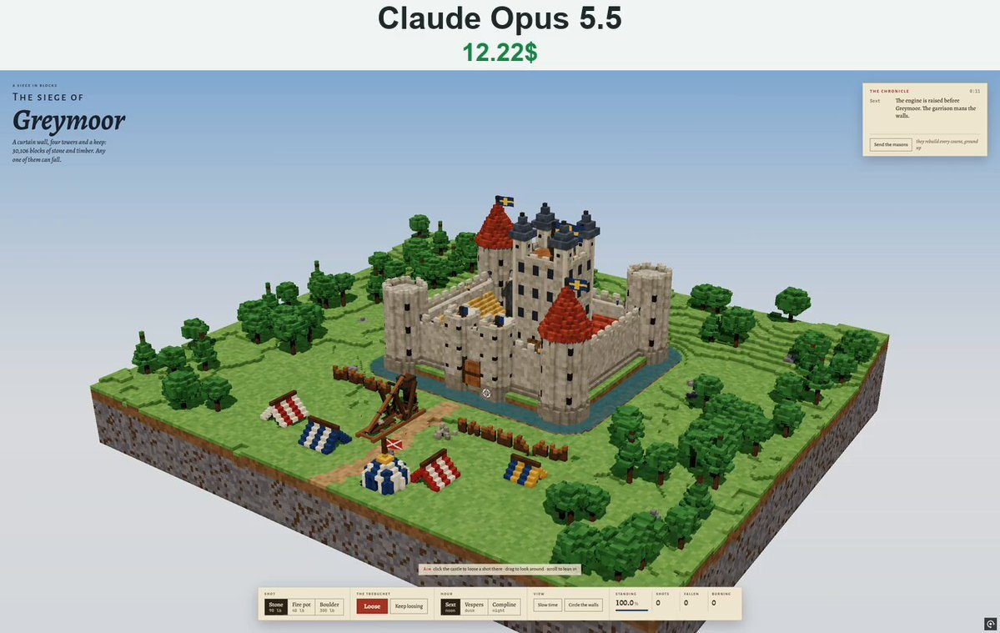

# 围攻灰沼堡 Siege of Greymoor

- **类型**：交互网页 / 体素 3D 场景
- **技术栈**：three.js r160 · 体素 · 结构坍塌 · 单文件 HTML
- **标签**：`three.js` `voxel` `体素` `城堡` `投石机` `物理破坏` `vibe-coding` `ai-测试`
- **测试模型**：Claude Opus 5.5
- **来源**：[@vib3coded](https://x.com/vib3coded) · [原帖](https://x.com/vib3coded/status/2114295486299664582) · [提示词帖](https://x.com/vib3coded/status/2114295834611212692) · 2026-10-25（北京时间） · 试玩：[Claude Opus 5.5](https://claude.ai/artifact/MwjyiCaPWp5rhi6MT2wcNJ)

> 说明：这是 [@vib3coded](https://x.com/vib3coded) 公开分享的提示词（测试模型见上）。界面上的按钮、标题、提示语等文字按原提示词要求保持英文（引号里的英文原样保留）。优先使用英文原文；中文翻译附在后面。

---

## 效果



## 提示词（英文原文）

```text
Build a single-file HTML voxel toy called "Siege of Greymoor" with three.js r160 (ES modules via import map from jsDelivr). Use OrbitControls, EffectComposer, UnrealBloomPass and OutputPass.

World
- A dense voxel grid of 176×64×148 cells (Uint8 material ids plus a "part" id per cell).
- Mesh it in 16³ chunks: emit only faces toward air, with per-vertex ambient occlusion and vertex colors. Remesh only dirty chunks, under a per-frame budget.
- Add an emissive vertex attribute so glass windows and torches glow at night.
- Lay out an original medieval castle on a mound, ringed by a water moat:
  - curtain walls with a wall-walk, parapet and merlons;
  - four round corner towers on footings; two get red shingle cones and waving cloth banners;
  - a gatehouse with drum towers, a portcullis grid and a raised drawbridge;
  - a tall keep with glowing windows and four slate-roofed turrets;
  - a timber-framed great hall with a thatched roof, a stable, a smithy and a well.
- Outside the castle: a siege camp with striped tents, a pavilion, a palisade, a camp fire and a pile of shot. Add pine and leafy trees and boulders, all on a floating terrain slab.

Physics
- Debris: an InstancedMesh of tumbling cubes. Move each axis separately against the grid. Debris sinks slowly in the moat and settles back into the grid as rubble.
- Structural support: a span-limited 0-1 BFS from grounded columns. Stepping up costs 0; sideways or down costs 1.
- Each material has a maximum span (stone 5, timber 9, iron 12, leaves 14, and so on). Blocks beyond their span detach.
- Small detached sets become debris. Large sets become a rigid falling piece that tips away from the lost support and shatters on impact.
- At startup, run a dry pass and prune any blocks that would be unsupported.
- Fire: timber, thatch, cloth and leaves catch. Fire spreads upward faster than sideways or down. Burnt blocks turn to charcoal or fall in, then trigger a support check.
- Visuals for fire: an additive glow box per burning block, orange flame and ember point sprites, dark smoke, and a few flickering point lights.

Siege
- A box-built trebuchet with a counterweight and a sling that turns to face the target.
- Shot cycle: swing, release on a ballistic arc (gravity 26), follow-through, wind back.
- Three shots:
  - stone, crater radius 3.4;
  - fire pot, ignites what it hits;
  - boulder, crater radius 5.2.
- Craters are ragged and stretched along the line of flight. Hits throw dust and moat spray.
- Archers patrol the wall-walks and fall when the stone under them goes. Banners drop when their pole's base is destroyed.
- The masons rebuild the castle layer by layer from a saved copy, 16 layers per second.

Lighting and UI
- Three hours, each with its own sun direction, hemisphere light, sky gradient, fog, emissive glow, bloom and exposure:
  - Sext (noon);
  - Vespers (dusk);
  - Compline (night).
- Darken unlit particles at night.
- Vellum-and-ink medieval interface using the fonts Alegreya, Alegreya Sans SC and JetBrains Mono:
  - italic title "The siege of Greymoor" top left, which turns light at dusk and night;
  - a "chronicle" log top right that writes plain sentences such as "A 300-lb boulder strikes the south-east tower and breaks it open.", "The banner on the walls comes down." and "Fire takes hold on the great hall.", plus a "Send the masons" button;
  - a bottom dock with these groups: shot type, Loose / Keep loosing, hour, view (Slow time, Circle the walls), and a tally of standing %, shots, fallen and burning.
- Click to aim, drag to orbit. Keyboard: space fires, keys 1–3 pick the shot.
- Responsive down to phone width.
```

---

## 提示词（中文）

用 three.js r160（通过 import map 从 jsDelivr 引入 ES 模块）构建一个名为 "Siege of Greymoor"（围攻灰沼堡）的单文件 HTML 体素玩具。使用 OrbitControls、EffectComposer、UnrealBloomPass 和 OutputPass。

### 世界

- 一个 176×64×148 的密集体素网格（每格一个 Uint8 材质 id，外加一个"部件" id）。
- 按 16³ 的区块生成网格：只输出朝向空气的面，带逐顶点环境光遮蔽和顶点颜色。只重建脏区块，并控制在每帧预算内。
- 加一个自发光顶点属性，让玻璃窗和火把在夜里发光。
- 在一座土丘上布置一座原创的中世纪城堡，四周环绕护城河：
  - 带城墙走道、胸墙和城垛的幕墙；
  - 四座建在基座上的圆形角塔；其中两座有红色木瓦锥顶和飘动的布旗；
  - 一座带鼓形塔楼、闸门格栅和升起的吊桥的门楼；
  - 一座窗户发光的高大主堡，带四座石板瓦顶的小塔；
  - 一座茅草屋顶的木框架大厅、一个马厩、一个铁匠铺和一口井。
- 城堡外：一座围城营地，有条纹帐篷、一座大帐、一道木栅栏、一堆篝火和一堆炮弹石。加上松树、阔叶树和巨石，全部在一块浮空地形板上。

### 物理

- 碎块：一个由翻滚立方体组成的 InstancedMesh。每个轴分别对网格做碰撞移动。碎块在护城河里缓慢下沉，最后作为瓦砾落回网格。
- 结构支撑：从着地的柱子出发、限制跨度的 0-1 BFS。向上走代价 0；横向或向下代价 1。
- 每种材质有最大跨度（石头 5、木材 9、铁 12、树叶 14 等）。超出跨度的方块会脱落。
- 脱落的小块集合变成碎块。大块集合变成一个刚性下落的整体，朝失去支撑的方向倾倒，落地时摔碎。
- 启动时先跑一遍空检查，剔除所有会失去支撑的方块。
- 火：木材、茅草、布和树叶会着火。火向上蔓延比横向或向下快。烧过的方块变成木炭或塌落，然后触发一次支撑检查。
- 火的视觉效果：每个燃烧方块一个加法混合的发光盒，橙色火焰和余烬点精灵，黑烟，以及几盏闪烁的点光源。

### 攻城

- 一架方块搭成的配重投石机（trebuchet），带配重和投索，会转向目标。
- 发射循环：摆动，沿弹道弧线释放（重力 26），随势摆动，回绕复位。
- 三种弹药：
  - 石弹，弹坑半径 3.4；
  - 火罐，点燃击中的东西；
  - 巨石，弹坑半径 5.2。
- 弹坑参差不齐，并沿飞行方向拉长。击中时扬起尘土和护城河水花。
- 弓箭手在城墙走道上巡逻，脚下的石头被打掉时会掉下去。旗杆底部被摧毁时旗帜落下。
- 石匠们按保存的副本逐层重建城堡，每秒 16 层。

### 光照和界面

- 三个时辰，每个有自己的太阳方向、半球光、天空渐变、雾、自发光强度、泛光和曝光：
  - Sext（正午）；
  - Vespers（黄昏）；
  - Compline（夜晚）。
- 夜里把不发光的粒子调暗。
- 羊皮纸加墨水风格的中世纪界面，字体用 Alegreya、Alegreya Sans SC 和 JetBrains Mono：
  - 左上角斜体标题 "The siege of Greymoor"，黄昏和夜晚时变成浅色；
  - 右上角一个 "chronicle"（编年史）日志，用平实的句子记录，例如 "A 300-lb boulder strikes the south-east tower and breaks it open."（一块 300 磅的巨石击中东南塔，把它砸开了）、"The banner on the walls comes down."（城墙上的旗帜落下了）和 "Fire takes hold on the great hall."（大厅着火了），外加一个 "Send the masons"（派石匠）按钮；
  - 底部栏分组：弹药类型、Loose / Keep loosing（发射 / 持续发射）、时辰、视角（Slow time 慢动作、Circle the walls 环绕城墙），以及计数：完好率 %、发射数、倒塌数和燃烧数。
- 点击瞄准，拖动环绕。键盘：空格发射，1–3 键选择弹药。
- 响应式布局一直适配到手机宽度。
