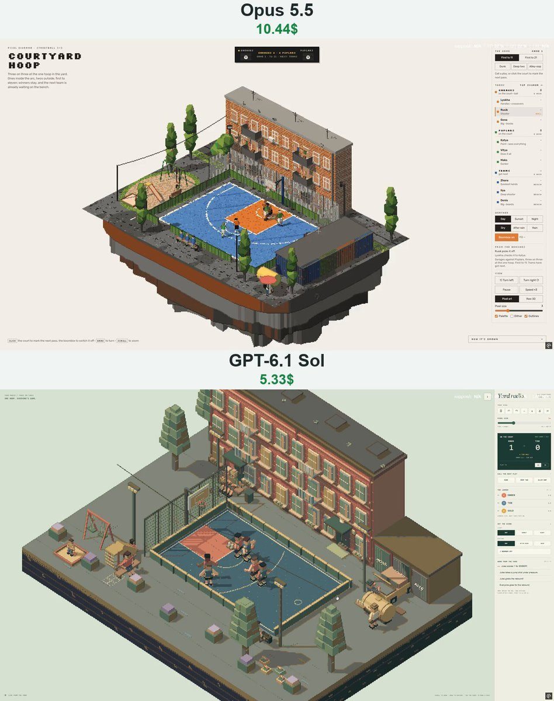

# 院子街球 Streetball Courtyard

- **类型**：交互网页 / 像素风场景
- **技术栈**：three.js · 像素后处理 · 篮球物理 · 单 HTML
- **标签**：`three.js` `像素风` `街头篮球` `体育模拟` `vibe-coding` `ai-测试`
- **测试模型**：Claude Opus 5.5 vs GPT-6.1 Sol
- **来源**：[@vib3coded](https://x.com/vib3coded) · [原帖](https://x.com/vib3coded/status/2115106186831823065) · [提示词帖](https://x.com/vib3coded/status/2115106339789701545) · 2026-10-27（北京时间） · 试玩：[Claude Opus 5.5](https://claude.ai/artifact/3E8rcYvhzscNni9pqkciXM) · [GPT-6.1 Sol](https://yard-radio.vercel.app/)

> 说明：这是 [@vib3coded](https://x.com/vib3coded) 公开分享的提示词（测试模型见上）。界面上的按钮、标题、提示语等文字按原提示词要求保持英文（引号里的英文原样保留）。优先使用英文原文；中文翻译附在后面。

---

## 效果



## 提示词（英文原文）

```text
Build a real-time pixel-art isometric diorama of 3x3 streetball at a single hoop in a city courtyard, as a single HTML page using three.js (WebGL). A floating island of asphalt holds a painted half court (faded blue with an orange key, worn white lines, the two-point arc) inside a box of low green boards. One hoop stands on a steel pole with a steel backboard, an orange ring and a chain net, with a wire fence behind it.
Around the court: a three-storey brick block of flats with balconies and washing, two grannies on a bench by the door, pigeons on the roof. A row of tin garages with original graffiti tags, and an old boxy car half out with its bonnet up and a man working on it. A playground with working swings, a slide and a sandpit, plus a mother on a bench. A kvass barrel with a seller, poplars, floodlight masts, and a wire with a pair of sneakers hanging from it.
Render at low resolution with an orthographic camera, snap colours to a fixed 64-colour OKLab palette and draw depth outlines. After rain, puddles reflect the scene.
Simulate the ball physically: drag, lively bounces off dry asphalt and duller ones off wet, a steel backboard, the ring as a real torus (rim-outs, rolls, lips) and a chain net that swishes. Solve every jump shot numerically through the flight with drag, at an arc that steepens close in, then add hand error that grows with distance, a defender's contest and a weaker shooter. Make layups steep; put dunks through from above with the shooter hanging on the rim; throw alley-oops as lobs to a point over the ring.
AI: dribbling with a hand that rides the ball, crossovers, drives, open-shot decisions, passes (chest, bounce, lob), cuts and screens. Man-to-man defence with help on drives, reach-in steals, contests and blocks, box-outs and rebounds caught with a jump.
Rules: ones inside the arc, twos outside; after a make the other team takes the ball from under the ring and must clear it past the arc; check at the top after out-of-bounds. First to 11 or 21. Three teams: winners stay, the losers walk off to the bench and the next team walks on.
Life in the yard: grannies feed the pigeons and complain about the boombox, the waiting team nods to the music and goes for kvass, a cat stalks the pigeons, children swing and slide. Day/sunset/night with floodlights and lit windows; dry, after-rain puddles, or rain with rings.
UI: a scoreboard; a side rail with three team ladders, called plays (dunk, deep two, alley-oop), weather and a boombox toggle, field-goal stats and a live feed; click the court to mark the next pass. Original characters only, English UI, responsive down to phone width.
```

---

## 提示词（中文）

构建一个实时像素风等距微缩场景：城市院子里单个篮筐下的 3x3 街头篮球，做成一个使用 three.js（WebGL）的单 HTML 页面。一座柏油浮空岛上有一块涂装的半场（褪色的蓝色，橙色三秒区，磨损的白线，两分线弧），四周围着一圈矮矮的绿色挡板。一个篮筐立在钢管上，钢制篮板，橙色篮圈，铁链篮网，后面是铁丝网。

### 球场周围

一栋三层砖砌住宅楼，有阳台和晾着的衣服，门口长椅上坐着两位老奶奶，屋顶上有鸽子。一排铁皮车库，上面有原创涂鸦签名；一辆老式方头小汽车半开出车库，引擎盖掀开，一个男人在修车。一个游乐场，有能真的荡起来的秋千、滑梯和沙坑，长椅上坐着一位妈妈。一个格瓦斯（kvass）桶和卖格瓦斯的人、杨树、泛光灯杆，以及一根电线上挂着一双球鞋。

### 渲染

用正交相机以低分辨率渲染，颜色吸附到固定的 64 色 OKLab 调色板，并绘制深度描边。雨后，水洼会倒映场景。

### 球的物理

对球做真实的物理模拟：空气阻力，在干燥柏油上弹得活泼、在湿地上弹得发闷，钢制篮板，篮圈是真正的圆环体（磕框弹出、在框上滚、转一圈）以及会刷的一声的铁链网。每一次跳投都在带阻力的飞行过程中数值求解，越近弧度越陡，然后加上随距离增大的手部误差、防守者的干扰和较弱投手的偏差。上篮要陡；扣篮从上方塞进去，扣篮者挂在篮圈上；空中接力以高吊球的形式传到篮圈上方的某一点。

### AI

运球时手跟着球走，胯下 / 交叉换手，突破，空位投篮决策，传球（胸前、击地、高吊），切入和掩护。人盯人防守，对突破有协防，伸手抢断，干扰和封盖，卡位，起跳抢篮板。

### 规则

弧内进球算 1 分，弧外算 2 分；进球后由另一队在篮下拿球，必须先把球带出弧外；出界后在弧顶交球确认（check）。先到 11 或 21 分获胜。三支队伍：赢者留场，输的一方走到长椅上，下一队上场。

### 院子里的生活

老奶奶喂鸽子，抱怨音箱太吵；等候的队伍跟着音乐点头，跑去买格瓦斯；一只猫潜伏着靠近鸽子；孩子们荡秋千、滑滑梯。白天 / 日落 / 夜晚（夜里有泛光灯和亮着的窗户）；晴天、雨后水洼，或者下雨（带雨圈）。

### 界面

记分板；侧边栏里有三支队伍的排位、可指定的战术（dunk 扣篮、deep two 远投两分、alley-oop 空中接力）、天气和音箱开关、投篮命中统计和实时战报；点击球场可以标记下一次传球的位置。只用原创角色，界面用英文，响应式布局一直适配到手机宽度。
