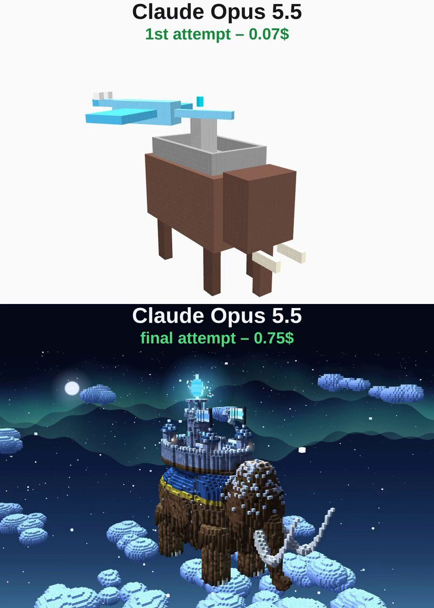

# 猛犸冰霜要塞 Mammoth Frost Fortress

- **类型**：交互网页 / 体素 3D 场景
- **技术栈**：three.js · 体素 · 单文件 HTML
- **标签**：`three.js` `voxel` `体素` `猛犸` `冰龙` `vibe-coding` `ai-测试`
- **测试模型**：Claude Opus 5.5
- **来源**：[@vib3coded](https://x.com/vib3coded) · [原帖](https://x.com/vib3coded/status/2116533061495947270) · [提示词帖](https://x.com/vib3coded/status/2116533224780308941) · 2026-10-31（北京时间） · 试玩：[Claude Opus 5.5](https://claude.ai/artifact/Qv572bYQ9jeipiBEdXvNKm)

> 说明：这是 [@vib3coded](https://x.com/vib3coded) 公开分享的提示词（测试模型见上）。界面上的按钮、标题、提示语等文字按原提示词要求保持英文（引号里的英文原样保留）。优先使用英文原文；中文翻译附在后面。

---

## 效果



## 提示词（英文原文）

```text
Create a single self-contained HTML file using Three.js that renders a beautiful animated voxel-art 3D scene. A giant woolly mammoth walks across a sea of clouds through a snowy night with the northern lights and a moon; the clouds drift backwards under its feet, and snow puffs up at every step.

On its back, over a blue blanket with gold trim and leather straps, stands a stone frost fortress: walls with battlements, four round turrets with blue conical roofs and flags, two small houses with glowing windows and smoking chimneys, and a central keep with a big glowing ice crystal floating and slowly rotating above it. The mammoth has shaggy fur, a swaying trunk, long curved tusks and snow on its head.

A crystalline ice dragon with horns, ice spikes along its back, glowing eyes and large wings rises from the clouds and circles the mammoth, leaving a trail of snowflakes, and breathes frost twice.

Add soft shadows, voxel ambient occlusion, a snowstorm, drifting voxel clouds and a slow cinematic camera orbit. Make it as detailed and polished as possible.
```

---

## 提示词（中文）

创建一个独立的单 HTML 文件，用 Three.js 渲染一个精美的动画体素（voxel）风 3D 场景。一头巨大的猛犸象在雪夜里走过一片云海，天上有极光和月亮；云在它脚下向后飘，每走一步都会扬起一团雪。

它背上铺着一块带金边和皮带的蓝色毯子，毯子上立着一座石砌的冰霜要塞：带垛口的城墙，四座圆塔（蓝色锥形尖顶，插着旗），两间窗户亮着、烟囱冒烟的小房子，以及一座中央主堡，主堡上方漂浮着一颗巨大的发光冰晶，缓缓旋转。猛犸象有蓬松的长毛、会摆动的鼻子、又长又弯的象牙，头上积着雪。

一条带角的水晶冰龙从云中升起，背上有一排冰刺，眼睛发光，翅膀很大；它绕着猛犸象盘旋，身后留下一串雪花，并喷两次寒霜吐息。

加上柔和阴影、体素环境光遮蔽（AO）、暴风雪、飘动的体素云，以及缓慢的电影感环绕镜头。做得尽可能细致、精良。
