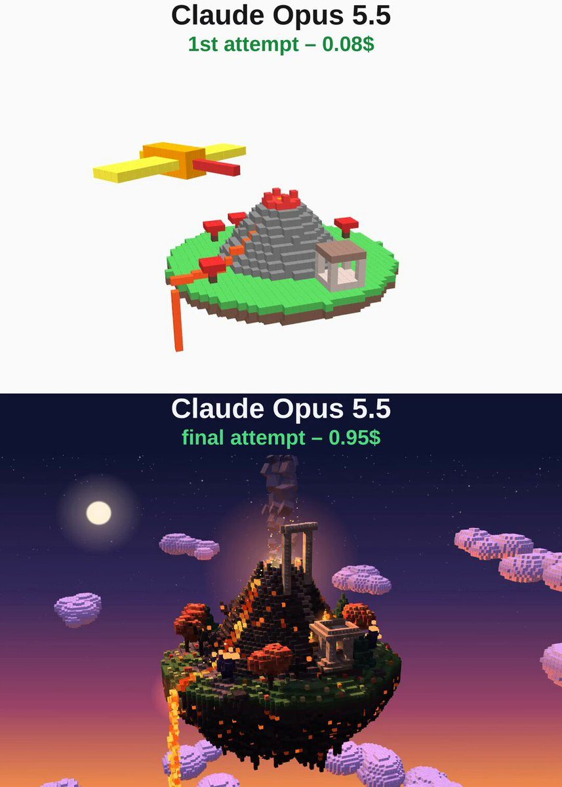

# 火山凤凰岛 Volcano Phoenix Island

- **类型**：交互网页 / 体素 3D 场景
- **技术栈**：three.js · 体素 · 单文件 HTML
- **标签**：`three.js` `voxel` `体素` `火山` `凤凰` `vibe-coding` `ai-测试`
- **测试模型**：Claude Opus 5.5
- **来源**：[@vib3coded](https://x.com/vib3coded) · [原帖](https://x.com/vib3coded/status/2116256139033686460) · [提示词帖](https://x.com/vib3coded/status/2116256339492245992) · 2026-10-31（北京时间） · 试玩：[Claude Opus 5.5](https://claude.ai/artifact/5XLJQoVEboJJD8UVm2Wz64)

> 说明：这是 [@vib3coded](https://x.com/vib3coded) 公开分享的提示词（测试模型见上）。界面上的按钮、标题、提示语等文字按原提示词要求保持英文（引号里的英文原样保留）。优先使用英文原文；中文翻译附在后面。

---

## 效果



## 提示词（英文原文）

```text
Create a single self-contained HTML file using Three.js that renders a beautiful animated voxel-art 3D scene. A floating volcanic island hangs in a dusk-to-night sky with stars and a moon.

In the center is a volcano with bubbling lava in its crater. A lava river runs down the slope and pours off the edge of the island as a fiery lavafall. On the slope stands an ancient pale-stone shrine with pillars and fire braziers, and a stone stairway leads up to an arch on the crater rim. Glowing cracks run through the dark basalt; add obsidian crystals, charred trees, red maples and pines, and rocky stalactites under the island.

A fiery phoenix is reborn from the lava in the crater: it rises in a spiral and circles the volcano, flapping its wings, with a long flowing tail and a trail of sparks, lighting up the island as it passes. Smoke and embers rise from the crater.

Add soft shadows, voxel ambient occlusion, drifting voxel clouds, flickering lava and a slow cinematic camera orbit. Make it as detailed and polished as possible.
```

---

## 提示词（中文）

创建一个独立的单 HTML 文件，用 Three.js 渲染一个精美的动画体素风 3D 场景。一座浮空火山岛悬在从黄昏过渡到夜晚的天空中，有星星和月亮。

岛的中央是一座火山，火山口里的熔岩在冒泡。一条熔岩河顺着山坡流下，从岛的边缘倾泻而出，形成一道炽热的熔岩瀑布。山坡上立着一座古老的浅色石头神殿，有石柱和火盆；一条石阶通向火山口边缘的一座拱门。深色玄武岩上布满发光的裂纹；再加上黑曜石晶体、烧焦的树、红枫和松树，以及岛底下的岩石钟乳。

一只火凤凰从火山口的熔岩中重生：它螺旋上升，绕着火山盘旋，扇动翅膀，拖着一条长长的飘逸尾羽和一串火花，经过时照亮整座岛。火山口里升起烟和余烬。

加上柔和阴影、体素环境光遮蔽、飘动的体素云、闪烁的熔岩，以及缓慢的电影感环绕镜头。做得尽可能细致、精良。
