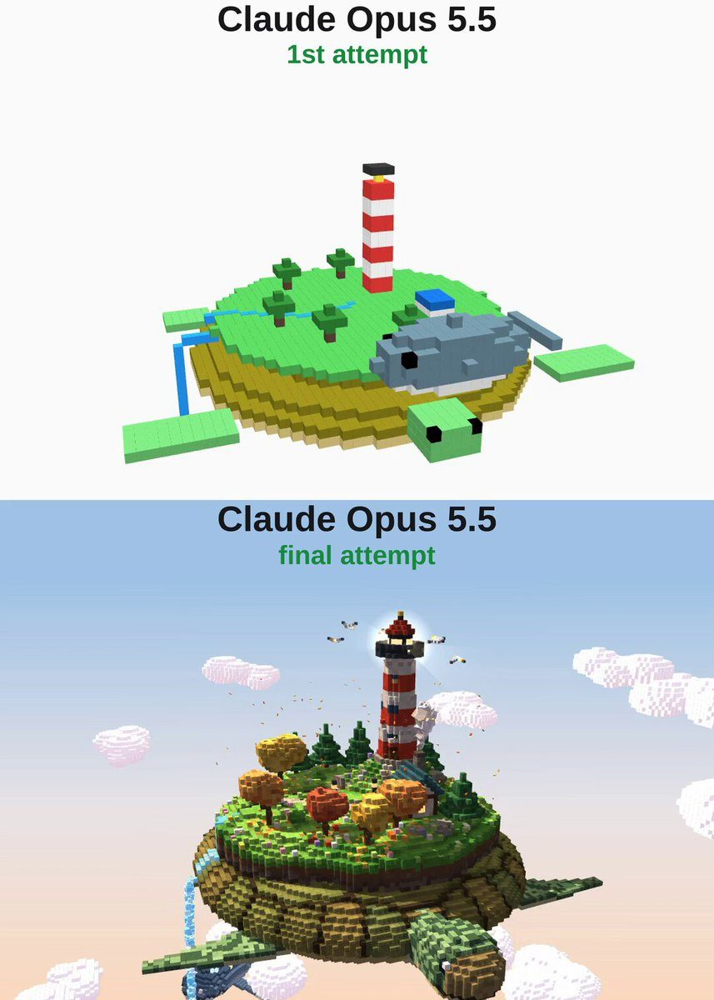

# 海龟浮岛 Turtle Island

- **类型**：交互网页 / 体素 3D 场景
- **技术栈**：three.js · 体素 · 单文件 HTML
- **标签**：`three.js` `voxel` `体素` `海龟` `灯塔` `vibe-coding` `ai-测试`
- **测试模型**：Claude Opus 5.5
- **来源**：[@vib3coded](https://x.com/vib3coded) · [原帖](https://x.com/vib3coded/status/2116169391301607810) · [提示词帖](https://x.com/vib3coded/status/2116169637427654837) · 2026-10-30（北京时间） · 试玩：[Claude Opus 5.5](https://claude.ai/artifact/WkpMiKqcRQS6gdD9rEKQ67)

> 说明：这是 [@vib3coded](https://x.com/vib3coded) 公开分享的提示词（测试模型见上）。界面上的按钮、标题、提示语等文字按原提示词要求保持英文（引号里的英文原样保留）。优先使用英文原文；中文翻译附在后面。

---

## 效果



## 提示词（英文原文）

```text
Create a single self-contained HTML file using Three.js that renders a beautiful animated voxel-art 3D scene. A floating island rests on the shell of a giant sea turtle that slowly swims through the clouds in a golden-hour sky.

On the island: a red-and-white striped lighthouse on a hill with a glowing lantern and a rotating light beam, a keeper's cottage with a smoking chimney, autumn trees (orange, gold, red) and dark pines, a pond with a rowboat, a stream that runs down the shell and spills off as a waterfall, flowers, rocks, pumpkins and lamp posts along a path.

The turtle has a patterned shell with scutes, a scaly head and flippers that paddle slowly; the island gently bobs with each stroke. A huge voxel humpback whale with glowing spots rises from the clouds below and swims in a spiral around the island, leaving a trail of sparkles. Seagulls circle the lighthouse.

Add soft shadows, voxel ambient occlusion, drifting voxel clouds, falling leaves, a gradient sky and a slow cinematic camera orbit. Make it as detailed and polished as possible.
```

---

## 提示词（中文）

创建一个独立的单 HTML 文件，用 Three.js 渲染一个精美的动画体素风 3D 场景。一座浮空小岛驮在一只巨大海龟的背甲上，海龟在金色时刻（golden hour）的天空里，缓缓地在云中游动。

岛上有：小山上一座红白条纹的灯塔，灯室发光，光束在旋转；一间烟囱冒烟的守塔人小屋；秋天的树（橙、金、红）和深色松树；一个停着小划艇的池塘；一条小溪顺着龟壳流下，从边缘倾泻成瀑布；还有花、石头、南瓜，以及小路两旁的路灯。

海龟的背甲有分块的盾片花纹，头上有鳞，四肢鳍慢慢划水；小岛随着每一次划水轻轻起伏。一头带发光斑点的巨大体素座头鲸从下方的云里升起，绕着小岛螺旋游动，身后留下一串闪光。海鸥绕着灯塔盘旋。

加上柔和阴影、体素环境光遮蔽、飘动的体素云、飘落的树叶、渐变天空，以及缓慢的电影感环绕镜头。做得尽可能细致、精良。
