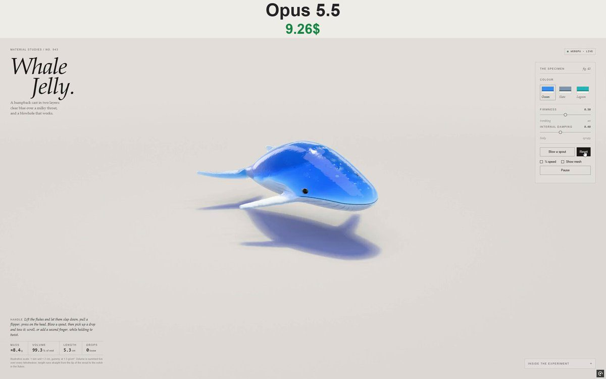

# 果冻座头鲸 Whale Jelly

- **类型**：交互网页 / 软体果冻
- **技术栈**：WebGPU · XPBD 四面体软体 · 单文件 HTML
- **标签**：`webgpu` `xpbd` `果冻` `座头鲸` `material-studies` `vibe-coding` `ai-测试`
- **测试模型**：Claude Opus 5.5
- **来源**：[@vib3coded](https://x.com/vib3coded) · [原帖](https://x.com/vib3coded/status/2114674922802782355) · [提示词帖](https://x.com/vib3coded/status/2114675119364653309) · 2026-10-26（北京时间） · 试玩：[Claude Opus 5.5](https://claude.ai/artifact/CDmzt6cuLfHqiw8EhxSXQv)

> 说明：这是 [@vib3coded](https://x.com/vib3coded) 公开分享的提示词（测试模型见上）。界面上的按钮、标题、提示语等文字按原提示词要求保持英文（引号里的英文原样保留）。优先使用英文原文；中文翻译附在后面。

---

## 效果



## 提示词（英文原文）

```text
Build a single-file interactive WebGPU soft-body study called "Whale Jelly" (Material Studies / No. 043), matching the quality of an earlier watermelon-slice jelly study. Subject: a humpback whale cast in two layers of gummy jelly, lying on its belly on a studio table.

Geometry: a signed-distance whale — an elliptical section swept along a curved spine (broad head with a flat crown, deep chest, narrow keeled tail stock), the belly pressed flat on the floor, smoothly joined to notched flukes with a scalloped trailing edge, long flippers with knobs along the leading edge, a small dorsal fin and twin blowhole dimples. Mesh it with surface nets and Newton projection; simulate it with a snapped hex lattice (5 tets per cell, a node layer on the floor) and XPBD (60 Hz, 10 substeps, co-rotational shape matching, volume constraints, edge damping, floor friction). Make the fins firmest and the clear body jelly softest.

Look: clear tinted jelly over a milky layer. The milky layer is its own embedded surface, cut by a wavy line along the flank that rises at the head into the mouth. Light it with key light absorbed through the jelly above it, measured from shadow-map depth. Draw throat pleats, a dark mouth groove, head tubercles and tail-stock knuckles in the shader from rest-space coordinates as bump-mapped relief. Add glossy dark bead eyes and a few trapped air bubbles. Render with refraction plus Beer–Lambert thickness from back-face depth, back-lit glow on the thin fins, a jelly-tinted floor shadow, PCSS soft shadows, contact AO, studio softbox reflections and GGX highlights, then PBR Neutral tone mapping.

Interaction: grab and stretch anywhere, with twist on scroll or a second finger. A "Blow a spout" button fires a column of rigid jelly drops from the blowhole along its deformed axis; the drops bounce, roll, land on the whale through its tets, and can be picked up and thrown.

UI (English, editorial style): masthead, live status pill, specimen panel (three colourways — Ocean, Slate, Lagoon; Firmness and Internal damping sliders; Blow / Reset; ¼ speed; Show mesh; Pause), live readouts (mass, volume %, length in cm snout-to-notch, loose drops), "Inside the experiment" notes, a WebGPU fallback and a stacked mobile layout.
```

---

## 提示词（中文）

构建一个名为 "Whale Jelly"（鲸鱼果冻，Material Studies / No. 043）的单文件交互式 WebGPU 软体研究，质量对标之前那件西瓜切片果冻研究。主题：一头用两层软糖果冻浇铸成的座头鲸，趴在摄影棚的桌面上。

### 几何

一头用有符号距离场构建的鲸——沿弯曲脊柱扫掠的椭圆截面（宽阔的头、平坦的头顶、深胸、窄而带龙骨的尾柄），腹部压平贴在地面上，平滑连接到带缺刻、后缘呈扇贝状的尾叶；长长的鳍肢，前缘有一排疙瘩；一个小背鳍和一对喷气孔凹坑。用 surface nets 加 Newton 投影生成网格；用吸附的六面体晶格（每格 5 个四面体，地面上有一层节点）和 XPBD 模拟（60 Hz，10 个子步，共旋形状匹配，体积约束，边阻尼，地面摩擦）。鳍最硬，透明的身体果冻最软。

### 外观

透明带色的果冻包着一层乳白层。乳白层是它自己独立嵌入的表面，被体侧一条波浪线切开，这条线在头部上扬进入嘴里。用主光照明，光穿过它上方的果冻被吸收（用阴影贴图深度来测量）。喉部褶沟、深色的嘴沟、头部的结节和尾柄的"指节"在着色器里用静止空间坐标画成凹凸贴图浮雕。加上有光泽的深色珠子眼睛和几个被困住的气泡。渲染：折射 + 用背面深度计算厚度的 Beer–Lambert 吸收、薄鳍上的背光透光辉光、带果冻颜色的地面阴影、PCSS 软阴影、接触 AO、摄影棚柔光箱反射和 GGX 高光，然后 PBR Neutral 色调映射。

### 交互

任意位置都可以抓住拉伸，滚轮或第二根手指可以扭转。"Blow a spout"（喷水）按钮会沿变形后的喷气孔轴向喷出一柱刚性果冻水滴；水滴会弹跳、滚动、通过四面体落在鲸身上，也可以捡起来扔。

### 界面（英文，杂志风）

刊头、实时状态胶囊、标本面板（三种配色 Ocean、Slate、Lagoon：海洋、石板、潟湖；Firmness 和 Internal damping 滑块；Blow / Reset；¼ speed；Show mesh；Pause）、实时读数（质量、体积 %、吻端到尾缺刻的长度（cm）、散落的水滴数）、"Inside the experiment" 说明、WebGPU 降级方案，以及手机上的纵向堆叠布局。
